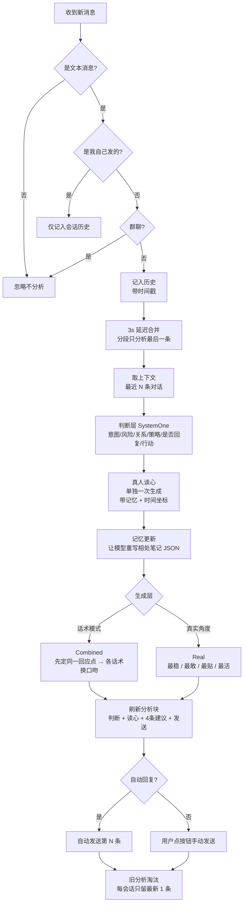

# Jev-Chat

> 一款 iOS 微信 AI 自动聊天助手 · Theos Tweak

`Jev-Chat` 是一个运行在 iOS 微信内的增强插件：它**自动读懂对方发来的消息**，给出「意图判断 + 真人读心」，并**生成 4 条风格不同的建议回复**，你可以一键点按发送，或让它全自动替你把话回了。

> 目标不是"机器人式"应答，而是**像真人一样会接话、有情商、不跑题、不越界**。

---

## 功能总览

| 模块 | 能力 |
|---|---|
| 意图判断 | 分析对方消息的真实意图、风险、行动建议、策略、双方关系 |
| 真人读心 | 像朋友私下分析：对方状态、潜台词、该拿捏的分寸、最不该踩的雷 |
| 建议回复 | 每次生成 4 条候选，风格各异、可直接发送 |
| 双模式 | **话术模式**（贴题 + 有分寸） / **真实角度模式**（敢接敢共情） |
| 话术池 | 内置多套话术风格（稳如老狗 / 情绪价值 / 夸夸 / 讨好型等），可多选 |
| 记忆档案 | 自动维护一份"相处笔记"，记住关系、里程碑、长期话题、近期动态、TA 的状态 |
| 记忆时效 | 给记忆按"距今多久"定权重，太久远的事不会当作当下语境 |
| 时间坐标 | 判断/读心/生成都带上当前时间与间隔，模型有"作息感"、不抱旧记忆 |
| 保持前台保活 | 通过 hook scene 更新让微信始终以"前台"运行，后台持续可用 |
| 悬浮按钮 | 屏幕悬浮图标，一键开关保活（toast 中文提示） |
| 自动回复 | 开启后收到消息自动发送选定的那一条 |
| 辅助功能 | 消息防撤回、微信运动步数（可一键 88888） |

---

## 截图演示

| 意图分析 | 真人读心 | 建议回复 |
|---|---|---|
|  |  |  |

---

## 分层架构

| 层 | 载体 | 职责 |
|---|---|---|
| Hook 层 | `WIAUI.xm` | 拦截微信收消息、渲染分析块、接管发送按钮 |
| 判断层 | `WIACore.xm` | 意图 / 风险 / 关系 / 策略 / 是否回复 / 行动 判断 |
| 读心层 | `WIACore.xm` | 单独一次生成，带记忆 + 时间坐标的真人读心 |
| 记忆层 | `WIACore.xm` | 相处笔记读写/重写、双写 + 隐蔽备份 + 兜底备份 |
| 生成层 | `WIACore.xm` | 按话术/真实角度起草 4 条建议回复 |
| 配置层 | `WIASettings.xm` | 设置页：开关、模型地址、话术选择、记忆档案管理 |
| 辅助层 | `WIAFeatures.xm` | 防撤回、微信运动、开关定义 |
| 保活层 | `WIAPreserve.xm` + `FloatingButtonWindow` + `CustomToastView` | 保持前台保活、悬浮按钮、提示 toast |

---

## 工作原理（一次完整对话）



**关键设计点**

- **判断 → 读心 → 记忆 → 生成** 四次独立模型调用，按此顺序串行，互不阻塞。
- **读心带记忆 + 时间坐标**：读懂对方时先看到关系、相处笔记，再结合"现在是几点、隔了多久"，判断更准。
- **记忆每消息重写**：每次对话后让模型重写一份"相处笔记" JSON，累积关系、话题、近期动态，并双写 + 隐蔽备份 + 兜底备份防丢失。
- **记忆时效**：笔记里带时间的信息按"距今多久"定权重——最近几小时是当下语境，几天前只作背景，很久前（尤其作息这类会变的）基本作废。
- **时间坐标**：判断/读心/生成都注入"当前时刻 + 距上次对话间隔 + 普通人作息常识推断"，模型不会拿很久前的旧事套当下（如早上的约定办完，下午对方"到了吗"会按新语境理解，而不是答"早餐马上到"）。
- **关系稳定**：关系是长期画像，一起出去玩/约饭等共同活动不改变关系，只有明确转折才调整。
- **只留最新 1 条、不持久化**：分析结果只显示当前最新消息，回复后即淘汰，不落盘、不占内存。
- **话术只换口吻，不换内容**：4 条候选先锁定「最该回应的一个点」，再分别用不同话术表达，杜绝答非所问。
- **通用立场边界**：你只是对方的聊天对象，不默认自己能替他办任何事——只接情绪、问清楚、陪着说一句。
- **保持前台保活**：通过 hook `FBSWorkspaceScenesClient` 吞掉"退后台"指令，让微信始终被系统当**前台 App** 运行，后台照常自动回复；悬浮按钮一键开关。

---

## 目录结构

```
chatgpt/
├── WIA.h                # 全局状态与开关声明
├── WIAUI.xm             # 消息 Hook / 渲染 / 历史 / 自动回复 / 发送
├── WIACore.xm           # 判断层 + 读心 + 记忆更新 + 生成层 + prompt + 时间坐标
├── WIASettings.xm       # 设置页 UI / 开关联动 / 记忆档案管理
├── WIAFeatures.xm       # 防撤回 / 微信运动 / 开关定义
├── WIAPreserve.xm       # 保持前台保活 hooks / 悬浮按钮联动
├── FloatingButtonWindow.h/.m  # 悬浮按钮窗口
├── CustomToastView.h/.m      # 提示 toast
├── Makefile             # Theos 构建配置
└── Jev-Chat.plist       # 注入声明
```

---

## 安装

> 需越狱环境（rootful），支持 arm64 / arm64e，微信主进程注入。

```bash
# 编译（需要 Theos）
export THEOS=/path/to/theos
make package

# 产物
./packages/me.ray.jev-chat_*.deb
```

用 Sileo / Zebra / Cydia 安装 `.deb`，重启微信即可。

---

## 配置说明

设置入口支持：**仅微信设置 / 仅插件 / 两者**。

| 配置项 | 说明 |
|---|---|
| 意图判断 | 开关 + 判断层模型地址 / Key / 模型 |
| 建议回复 | 开关 + 快捷回复 + 自动回复（第几条） |
| 关联上下文 | 判断层 / 生成层各自参考最近几条 |
| 话术模式（真实口吻） | 开 = 话术当底子；关 = 纯真实角度 |
| 话术选择 | 从多套话术中多选（开话术模式时显示） |
| 记忆档案 | 开关 + 清除记忆档案（分析结果不持久化、只留当前最新） |
| 微信运动 | 自定义总步数 / 瞬间到 88888 |
| 消息防撤 | 拦截撤回提示 |
| 后台运行 | 保持前台保活，微信始终以前台身份运行（悬浮按钮可快捷开关） |

---

## 模型接入

插件采用 **OpenAI 兼容** 请求格式（`chat/completions`），可灵活切换模型服务：

| 用途 | 建议模型 | 接入方式 |
|---|---|---|
| 判断层（SystemOne） | 结构化问答端点 | 设置页填 base / key / model |
| 生成回复 / 读心 / 记忆更新 | DeepSeek / 豆包 等 | 同上，OpenAI 兼容即可 |

**判断层怎么填**

判断层走结构化问答端点，三项配置格式：

| 配置项 | 填什么 | 说明 |
|---|---|---|
| 服务地址 | 完整 systemone 端点，或根地址 | 末尾是 `systemone/evaluate/decisions` → 原样使用；末尾是 `v1` → 自动补 `/systemone`；其他 → 自动补 `/v1/systemone` |
| Key 密钥 | 一段 token 字符串 | 请求时自动加 `Bearer` 前缀，**不要**自己带 "Bearer " |
| 模型 | 判断层模型名 | 例如 `decision-model-preview` |

示例（SystemOne 端点）：

```
服务地址 : https://llm-xxx.maas.aliyuncs.com/compatible-mode/v1/systemone
Key 密钥 : sk-你申请的token
模型    : decision-model-preview
```

> 说明：判断层默认走结构化问答端点（`/systemone`），请求体用 `state` + `questions` 结构。如果你的服务只提供普通 chat 接口，也可走 OpenAI 兼容的 `chat/completions`——此时地址填根地址即可，代码会自动补 `/chat/completions`。

以豆包（火山方舟）为例，仅需把生成层的 base / model / key 改成：

```
base : https://ark.cn-beijing.volces.com/api/v3
model: doubao-seed-2-1-pro-260628
key  : 你的 ARK_API_KEY
```

---

## 免责声明

本项目仅用于**学习、研究与个人技术探索**。

- 请勿将其用于骚扰、诈骗、营销轰炸或任何违反平台规则与法律法规的行为。
- 自动回复会代替你对外发消息，请自行对发出的内容负责。
- 插件依赖微信私有接口与 UI 结构，**微信版本更新可能导致部分功能失效**，请谨慎使用。

---

## License

内部学习项目 · 请遵守所在地区法律法规与微信用户协议。
