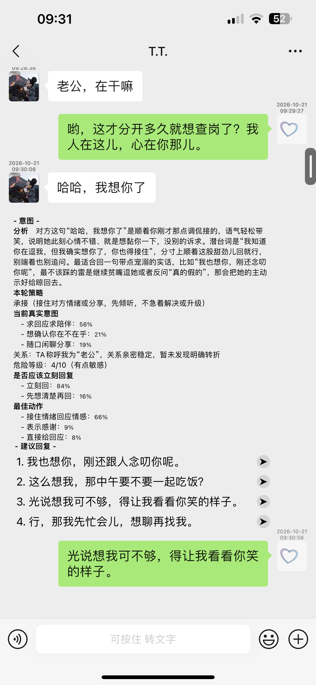
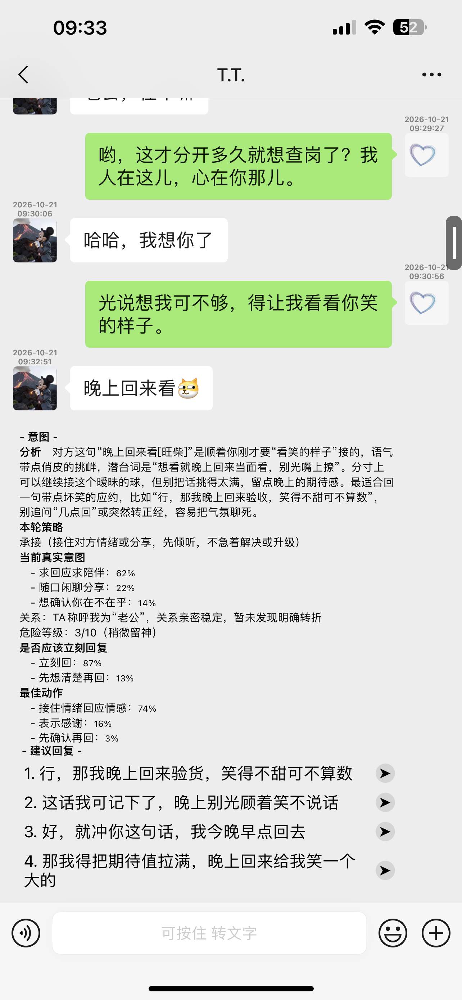
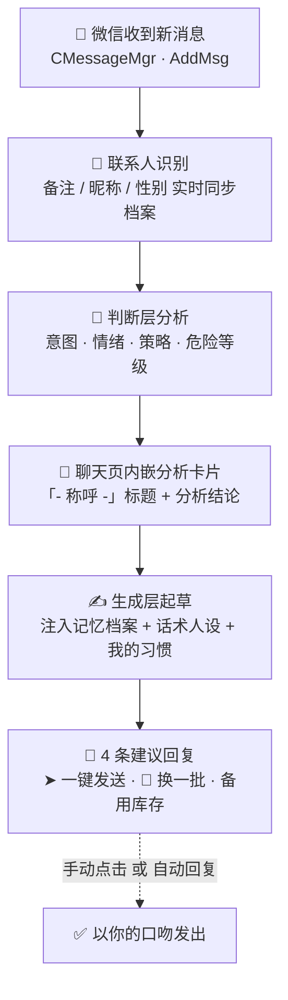
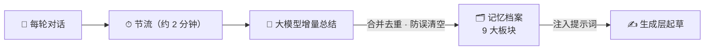

<div align="center">

# 💬 Jev-Chat for WeChat

### 微信 AI 高情商回话助手 · iOS 越狱插件

收到消息的一瞬间，聊天页里自动浮现一张**意图分析卡片**——
对方在想什么、情绪如何、该不该立刻回、怎么回最合适，一目了然；
并附上 **4 条像你自己说话的建议回复**，点击 ➤ 直接发送。

同时为每位联系人维护一份会成长的**记忆档案**，让 AI 越聊越懂 TA。

[]()
[]()
[]()
[]()
[]()

</div>

---

## 📸 效果预览

| 意图分析，一眼看穿 | 建议回复，一键发送 | 连续对话，越聊越准 |
|:---:|:---:|:---:|
|  |  |  |
| 真实意图概率分布、危险等级、<br>是否立刻回复、最佳动作 | 4 条不同策略的候选回复，<br>➤ 发送 · 🔄 换一批 | 结合记忆档案与上下文，<br>策略随对话节奏自动调整 |

---

## ✨ 功能总览

### 🧠 意图分析（判断层）

每条收到的消息，都会经过判断层大模型实时分析，以原生样式内嵌在聊天页：

| 卡片内容 | 说明 |
| --- | --- |
| **分析** | 对方这条消息的真实含义、情绪状态与言外之意 |
| **本轮策略** | 承接 / 推进 / 降温 / 试探等，告诉你这一轮该怎么接 |
| **当前真实意图** | 概率分布，如「求回应求陪伴 56% · 想确认你在不在乎 21% · 随口闲聊 19%」 |
| **关系** | 基于聊天内容与记忆档案自动判断双方关系 |
| **危险等级** | 0–10 分，标注这句话有多敏感、回错话的代价有多大 |
| **是否应该立刻回复** | 立刻回 / 先想清楚再回，带置信度 |
| **最佳动作** | 这轮最该做的事，如「接住情绪回应情感」 |

### ✍️ 建议回复（生成层）

| 功能 | 说明 |
| --- | --- |
| **4 条候选回复** | 不同策略、不同语气，覆盖分析给出的最佳动作 |
| **➤ 一键发送** | 点纸飞机直接以你的口吻发出 |
| **🔄 换一批** | 先吐备用库存，库存空了自动重新生成 |
| **快捷回复** | 在键盘上方常驻建议回复，不用展开分析卡片 |
| **自动回复** | 可指定自动发送第 N 条，人不在也能稳稳接住 |
| **话术模式** | 15 种人设可多选：高情商话术、贴吧老哥、拒绝加班、卑微乙方、稳如老狗、已读乱回、鱼塘主、职场黑话、阴阳怪气、情绪价值、夸夸、讨好型人格、狗头军师系列…… |
| **真实口吻** | 开启后模仿「我的说话习惯」落笔——话术只定方向，听起来还是你自己 |

### 🗂 记忆档案（模拟真实社交）

每个联系人一份、随聊天自动成长的档案，也可手动编辑：

| 板块 | 内容 |
| --- | --- |
| 这是TA | 对方的身份、性格、偏好画像 |
| 我们之间 | 关系定位与相处模式 |
| 长期话题 | 反复出现的话题，自动累计次数与最近时间 |
| 近期动态 | 最近 20 条动态（时间自动带上星期几） |
| 动态小结 | 大模型每轮重写的近期动态摘要 |
| TA最近 | 对方近期的状态与情绪 |
| 待办承诺 | 答应过的事、待兑现的承诺 |
| 画像小结 | 大模型对 TA 的整体画像提炼 |
| 我的习惯 | 你自己的说话偏好，生成层据此模仿你的口吻 |

- **称呼自动识别**：优先取微信备注，无备注取昵称，分析卡片标题直接显示；
- **性别自动同步**：读取微信资料（对方改了资料会实时跟随），未知则不传给大模型；
- **增量更新**：每轮对话后节流触发大模型总结，只改变化了的部分，防止误清空；
- **可手动编辑**：相处笔记支持逐条修改，改完即生效。

### 🛡 实用增强

| 功能 | 说明 |
| --- | --- |
| **消息防撤回** | 对方撤回消息时拦截并提示「已拦截 XX 撤回的消息」，名字都给你标好 |
| **微信运动步数** | 自定义目标步数，按一天作息平滑渐进 + 每日随机偏移防抖动，数据自然不穿帮 |
| **后台保活** | 场景修复 + 静音循环音频双保险，后台不闪退；无悬浮窗、零视觉打扰 |

### ⚙️ 设置中心

入口位置可选：**微信设置页内** / **独立插件入口** / **两者都要**。

- 双通道 API 独立配置：判断层、生成层各自的**服务地址 / Key / 模型 / 关联上下文条数**
- 用量统计：判断层 / 生成层分开的今日与累计 token 用量，可一键清零
- 记忆档案管理：查看联系人列表、逐个编辑、一键清除

---

## 🧠 工作流程

### 分析与回话主链路



### 记忆档案闭环



> 聊得越多 → 档案越厚 → 回复越像你、越懂 TA。

---

## 📦 安装

| 项目 | 要求 |
| --- | --- |
| 系统 | 已越狱 iOS（arm64） |
| 依赖 | mobilesubstrate ≥ 0.9.5000 |
| 作用域 | 仅注入微信（com.tencent.xin），不碰其他 App |
| 安装 | Sileo / Zebra 安装 `.deb`，装完重启微信 |

安装后在 **微信 → 我 → 设置** 里找到「Jev Chat」入口（或打开独立插件入口），填入你的 API 地址、Key 与模型即可开始。

## 🛠 从源码编译

```bash
git clone https://github.com/ray/Jev-Chat-for-WeChat.git
cd Jev-Chat-for-WeChat

# 需要 Theos 环境（https://theos.dev）
THEOS=~/theos make package

# 产物位于 packages/me.ray.jev-chat_*.deb
```

---

## 🧩 实现原理

不依赖任何微信头文件，全部运行时动态解析 + 异常兜底，微信小版本更新不易失效：

| Hook / 模块 | 作用 |
| --- | --- |
| `CMessageMgr · AddMsg:MsgWrap:` | 消息入口，触发判断层与生成层 |
| `MMContext → CContactMgr · getContactByName:` | 读取联系人备注 / 昵称 / 性别 |
| 撤回 sysmsg 通知 | 拦截撤回，提示发送者名字 |
| `WCDeviceStepObject · m7StepCount` | 微信运动步数注入 |
| Scene / UIApplication / UNCenter | 后台保活 + 场景修复 |
| 消息 Cell + Associated Objects | 原生样式内嵌分析卡片与建议回复 |

<details>
<summary><b>📁 目录结构</b></summary>

```
Jev-Chat-for-WeChat
├── WIA.h              // 公共常量 / 接口声明
├── WIACore.xm         // 核心：LLM 请求、缓存、记忆档案存取
├── WIAPrompts.xm      // 提示词与话术人设（调教只动这个文件）
├── WIAUI.xm           // 聊天页分析卡片 / 建议回复 UI
├── WIASettings.xm     // 设置中心 + 记忆档案管理界面
├── WIAFeatures.xm     // 防撤回 / 微信运动步数
├── WIAPreserve.xm     // 后台保活（场景修复 + 静音音频）
├── FloatingButtonWindow.*  // 保活音频引擎
├── CustomToastView.*       // 提示 UI
├── Jev-Chat.plist     // 注入过滤（仅微信）
└── Docs/              // 截图素材
```

</details>

---

## 🗓 近期更新亮点

- 记忆档案新增「动态小结」：近期动态由大模型自动总结，注入提示词更快更准
- 分析卡片标题显示联系人称呼（备注优先）；性别随微信资料实时同步、未知不传模型
- 建议回复「换一批」支持备用库存；刷新按钮加大间距，减少误触
- 长期话题自动累计次数；所有档案时间自动带上星期几
- 移除保活悬浮窗，保活静默化，零视觉打扰

<details>
<summary><b>查看完整更新日志</b></summary>

完整迭代记录见 git 提交历史（每轮优化独立成提交）。

</details>

---

## ⚠️ 免责声明

- 本项目**仅供学习与技术研究**，请勿用于任何违反法律或平台规则的场景；
- 需自备大模型 API（OpenAI 兼容接口），所有请求直接从设备发往你配置的服务地址，本项目不收集任何数据；
- AI 生成的内容可能不恰当，发送前请自行判断；与人相处，真诚永远是最好的话术。

---

<div align="center">

**如果这个项目帮到了你，点个 ⭐ Star 让更多人看到**

</div>
