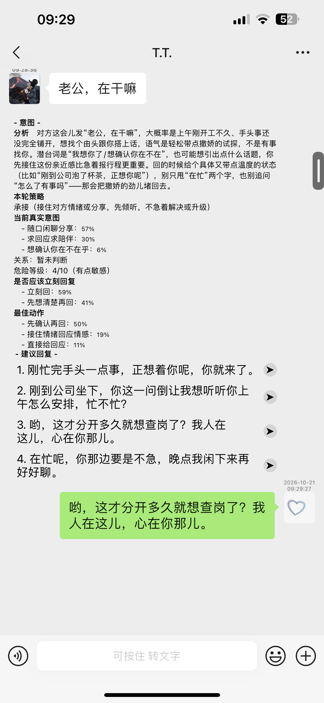
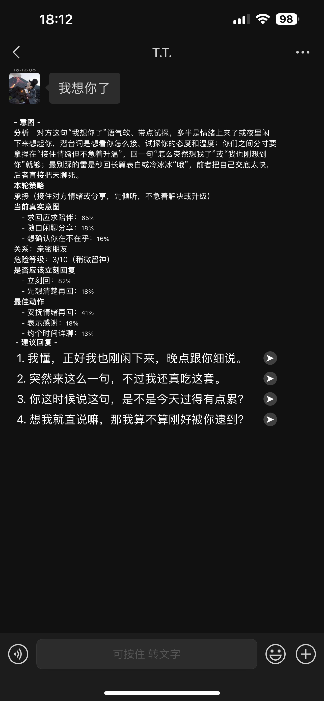
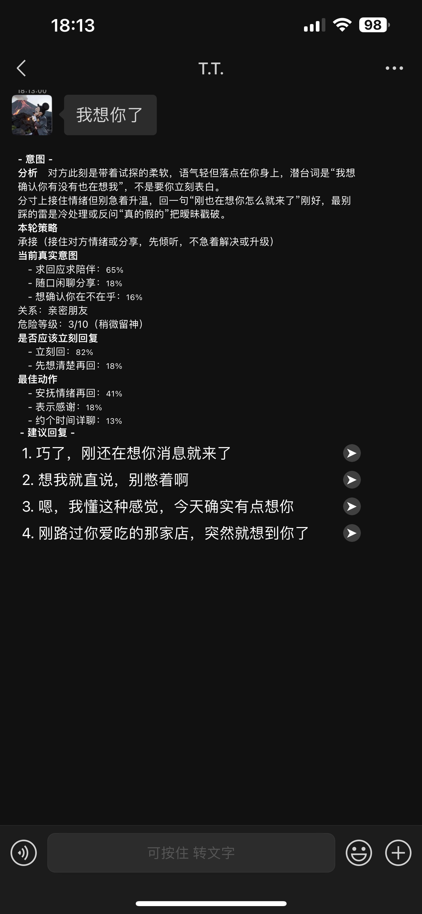
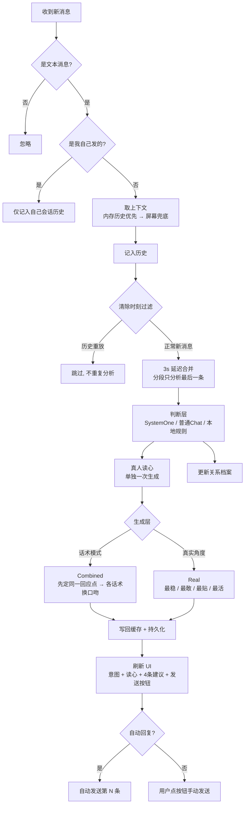

# Jev-Chat

> 一款 iOS 微信 AI 自动聊天助手 · Theos Tweak

`Jev-Chat` 是一个运行在 iOS 微信内的增强插件：它**自动读懂对方发来的消息**，给出「意图判断 + 真人读心」，并**生成 4 条风格不同的建议回复**，你可以一键点按发送，或让它全自动替你把话回了。

> 目标不是"机器人式"应答，而是**像真人一样会接话、有情商、不跑题、不越界**。

---

## 功能总览

| 模块 | 能力 |
|---|---|
| 意图判断 | 分析对方消息的真实意图、风险、行动建议、策略、双方关系 |
| 真人读心 | 像朋友私下分析：对方状态、潜台词、该拿捏的分寸、最不该踩的雷 |
| 建议回复 | 每次生成 4 条候选，风格各异、可直接发送 |
| 双模式 | **话术模式**（贴题 + 有分寸） / **真实角度模式**（敢接敢共情） |
| 话术池 | 内置 15 种话术风格，可多选，按你的偏好生成 |
| 关联上下文 | 分析时参考最近 N 条对话（0 / 3 / 5 / 8 / 12 / 20 条） |
| 关系档案 | 自动记住与对方的关系类型，越聊越懂分寸 |
| 自动回复 | 开启后收到消息自动发送选定的那一条（第 1–4 条） |
| 持久化与备份 | 分析记录 / 关系档案可存盘、可清除、有主文件 + 隐蔽备份双份 |
| 辅助功能 | 消息防撤、微信运动步数（可一键 88888）、后台保活 |

---

## 截图演示

| 意图分析 | 真人读心 | 建议回复 |
|---|---|---|
|  |  |  |

---

## 分层架构

| 层 | 载体 | 职责 |
|---|---|---|
| Hook 层 | `WIAUI.xm` | 拦截微信收消息、渲染分析块、接管发送按钮 |
| 判断层 | `WIACore.xm` | 意图 / 风险 / 行动 / 策略 / 关系 判断 |
| 生成层 | `WIACore.xm` | 真人读心 + 建议回复起草 |
| 状态层 | `WIACore.xm` | 上下文记忆、关系档案、持久化与备份 |
| 配置层 | `WIASettings.xm` | 设置页：开关、模型地址、话术选择、清除 |
| 辅助层 | `WIAFeatures.xm` | 防撤回、微信运动、后台保活 |

---

## 工作原理（一次完整对话）



**关键设计点**

- **话术只换口吻，不换内容**：4 条候选先锁定「最该回应的一个点」，再分别用不同话术表达，杜绝答非所问、编造情节。
- **通用立场边界**：你只是对方的聊天对象，不默认自己能替他办任何事——只接情绪、问清楚、陪着说一句，不写「我去帮你问 / 我去处理」这类越界话。
- **双模式分工**：正式/重要场合用话术模式求稳；熟人寒暄用真实角度放开接。

---

## 目录结构

```
chatgpt/
├── WIA.h              # 全局状态与开关声明
├── WIAUI.xm           # 消息 Hook / 渲染 / 历史 / 自动回复 / 发送
├── WIACore.xm         # 判断层 + 生成层 + prompt + 持久化 + 关系档案
├── WIASettings.xm     # 设置页 UI / 开关联动 / 清除
├── WIAFeatures.xm     # 防撤回 / 微信运动 / 后台保活
├── Makefile           # Theos 构建配置
└── Jev-Chat.plist     # 注入声明
```

---

## 安装

> 需越狱环境（rootful），支持 arm64 / arm64e，微信主进程注入。

```bash
# 编译（需要 Theos）
export THEOS=/path/to/theos
make package

# 产物
./packages/me.ray.jev-chat_*.deb
```

用 Sileo / Zebra / Cydia 安装 `.deb`，重启微信即可。

---

## 配置说明

设置入口支持：**仅微信设置 / 仅插件 / 两者**。

| 配置项 | 说明 |
|---|---|
| 意图判断 | 开关 + 判断层模型地址 / Key / 模型 |
| 建议回复 | 开关 + 快捷回复 + 自动回复（第几条） |
| 关联上下文 | 判断层 / 生成层各自参考最近几条 |
| 话术模式（真实口吻） | 开 = 话术当底子；关 = 纯真实角度 |
| 话术选择 | 从 15 种话术中多选（开话术模式时显示） |
| 持久化分析 | 开 = 分析记录存盘；关 = 不存盘 |
| 清除分析记录 | 一键删除分析记录（带备份） |
| 清除所有关系统计 | 删除关系档案，从零重建 |
| 微信运动 | 自定义总步数 / 瞬间到 88888 |
| 消息防撤 | 拦截撤回提示 |
| 后台运行 | 保活，防止被系统杀后台 |

---

## 模型接入

插件采用 **OpenAI 兼容** 请求格式（`chat/completions`），可灵活切换模型服务：

| 用途 | 建议模型 | 接入方式 |
|---|---|---|
| 判断层（SystemOne） | bocha 等结构化问答端点 | 设置页填 base / key / model |
| 判断层（普通 Chat） | OpenAI 兼容服务 | 同上 |
| 生成回复 | DeepSeek / 豆包 等 | 同上，OpenAI 兼容即可 |
| 真人读心 | 同上 | 同上 |

以豆包（火山方舟）为例，仅需把生成层的 base / model / key 改成：

```
base : https://ark.cn-beijing.volces.com/api/v3
model: doubao-seed-2-1-pro-260628
key  : 你的 ARK_API_KEY
```

---

## 免责声明

本项目仅用于**学习、研究与个人技术探索**。

- 请勿将其用于骚扰、诈骗、营销轰炸或任何违反平台规则与法律法规的行为。
- 自动回复会代替你对外发消息，请自行对发出的内容负责。
- 插件依赖微信私有接口与 UI 结构，**微信版本更新可能导致部分功能失效**，请谨慎使用。

---

## License

内部学习项目 · 请遵守所在地区法律法规与微信用户协议。
