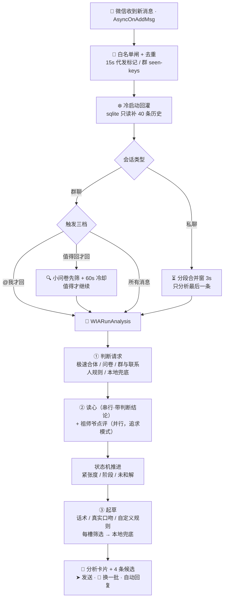
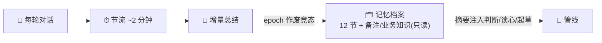

<div align="center">

# 💬 Jev-Chat for WeChat

### 微信 AI 高情商回话助手 · iOS 越狱插件

收到消息的一瞬间，聊天页里自动浮现一张**意图分析卡片**——
对方在想什么、情绪如何、该不该立刻回、怎么回最合适，一目了然；
并附上 **4 条像你自己说话的建议回复**，点击 ➤ 直接发送。

同时为每位联系人与每个群维护一份会成长的**记忆档案**，让 AI 越聊越懂 TA。

[]()
[]()
[]()
[]()
[]()

</div>

---

## ✨ 功能总览

### 📇 启用插件（白名单）

联系人与群分开管理：开关 + 微信原生选人界面（带头像、搜索、自动回显）。名单外零 token 消耗；总开关关闭则分析 / 建议回复 / 记忆 / 自动回复对所有人停用。防撤回 / 微信运动 / 后台保活是全局功能，不受名单影响。

### 🧠 意图分析（判断层）

每条收到的消息经大模型实时分析，以原生样式内嵌聊天页：

| 卡片内容 | 说明 |
| --- | --- |
| **分析** | 一句话读心：对方此刻状态、情绪与言外之意 |
| **本轮策略** | 承接 / 推进 / 收线等，告诉你这一轮该怎么接 |
| **当前真实意图** | 概率分布，如「想确认你在不在乎：52%」 |
| **关系** | 基于聊天内容与记忆档案自动判断双方关系 |
| **危险等级** | 0–10 分，回错话的代价有多大 |
| **是否应该立刻回复** | 立刻回 / 先想清楚再回，带置信度 |
| **最佳动作** | 这轮最该做的事 |

- **分步上屏**：判断先出卡片 → 读心随后补上 → 建议回复最后就位，不用等全部就绪
- **读心串行化**：读心在判断出结论后发出，显式带上意图与动作——只解释语气分寸，**不许推翻判断定论**（客服群问价不会被脑补成开玩笑）
- **会话状态机**：跨消息累积「紧张度 + 阶段」——连续冷暴力升级**紧急**、对方给台阶后**刹车**、跨天没和好进**破冰期**；冲突 / 台阶 / 破冰期自动回复暂停
- **群类型问卷**：非闲聊群的意图集按类型切换（客服 / 家族 / 公司 / 游戏各有专属心态池）
- **历史自动回灌**：sqlite3 只读直读微信消息库，重启后自动补最近约 40 条历史，老对话能接上；上下文快照晚于回灌落地时自动重取（竞态闭环）
- 没配判断层 Key 时本地规则兜底（含收线判别），零 token 消耗

### ✍️ 建议回复（生成层）

| 功能 | 说明 |
| --- | --- |
| **4 条候选回复** | 界面永远固定 4 条：**话术模式**按所选人设出（17 种内置可多选 1~4 + 自定义人设卡，粘贴 SKILL.md 自动清洗）；**真实口吻**按稳妥 / 敢 / 贴 / 活四档出，更像随手打字 |
| **➤ 一键发送 / 🔄 换一批** | 点纸飞机直接发；换一批先吐备用库存、用完自动重生成（排除已看过候选，连点不叠发） |
| **快捷回复** | 键盘上方常驻建议，不用展开卡片 |
| **采纳学习 / 不像我** | 点选过的回复（最近 12 条）作动态示例喂给起草；长按纸飞机 = 这条不像我，进起草红线与画像纠错层 |
| **模仿我的口吻** | 注入「我的说话习惯」+「我的数字画像」六层画像（硬规则/身份/表达/决策/人际/纠错），20h 自动修订、可手改 |
| **数字分身语料** | 一键导出 jsonl（LoRA 微调）+ markdown 对话材料（distilly 蒸馏），私聊群聊同池，插件代发自动排除 |
| **自动回复（按人 / 按群）** | 列表行右侧开关 + 选第 N 条；防连发（10 秒内最多 2 条）；代发带 bot 标记不自反馈 |

### 👥 群聊体系（群类型化）

| 功能 | 说明 |
| --- | --- |
| **5 类群型** | 闲聊通用 / 商业客服 / 家族群 / 公司群 / 游戏群——决定意图集、接话口径、笔记模板；**新群首次触发按群名自动猜类型**（猜错可改） |
| **群笔记** | 按类型的节结构自动建档（客服=业务概况/常见问题/常见客户…），可整篇编辑、恢复内置模板 |
| **业务知识** | 老板手写资料节：卖什么 / 价格带 / 发货 / 售后——**模型只读**（不在节清单，结构保证），回答价格政策以此为准 |
| **触发三档** | @我才回 / **值得回才回**（每条先 60 token 小问卷筛 + 60s 冷却）/ 所有消息都回；老设置自动迁移 |
| **群自定义规则** | 按群替换判断问卷与起草模板，内置 5 套模板（淘宝客服 / 工作群 / 同事闲聊 / 家长群 / 兴趣群）套用后直接改；开关「注入我的口吻」按群独立 |
| **按群自动回复** | 群笔记行右侧开关 + 第 N 条 |

### 🗂 记忆档案（模拟真实社交）

每个联系人一份、随聊天自动成长，也可手动编辑。12 节结构：这是TA / 我们之间 / 长期话题 / 近期动态 / 动态小结 / TA最近 / 待办承诺 / 画像小结 / 我的习惯 / **TA的表达习惯 · 吵架模式 · 和好方式**（distilly 框架——冲突期自动带吵架模式别撞雷，台阶期带上和好方式递对台阶）。

- **【备注】手写事实节**：TA 的过敏原、你的职业边界、相处铁律——**模型只读**（与群业务知识同一保护机制），判断 / 读心 / 起草都遵守
- **联系人自定义规则**：按人替换判断问卷与起草模板，内置 4 套模板（家人 / 领导客户 / 朋友 / 伴侣）+ 口吻开关，清空即回默认
- **增量更新**：约 2 分钟节流、epoch 代际作废竞态；「我的习惯」只从对方接住的发言提炼
- **防丢五层保险**：三策略读档 + 主文件 + 两代轮换备份 + defaults 镜像 + 沙盒外备份；删档 / 清档的迟到写盘被代际号关死
- **键盘避让**：全部编辑页键盘弹起自动让位并把**光标**滚进可视区

### 🛡 实用增强

| 功能 | 说明 |
| --- | --- |
| **消息防撤回** | 拦截撤回并提示发送者名字 |
| **微信运动步数** | 按作息平滑渐进 + 随机偏移防抖动 |
| **后台保活** | 场景修复 + 静音音频双保险；回前台踢一次同步救活长连接 |
| **配置迁移** | 一键导出 / 导入全部设置 + 记忆档案；两阶段校验、NSNull 自动剔除、坏文件只拒收 |
| **Key 存 Keychain** | API Key 不进 plist 不进备份 |
| **运行监控** | 崩溃现场（信号 + 栈）、主线程卡顿探针、启动体检；异常钩子保存回链不吞微信自己的 |

### ⚙️ 设置中心

入口：**微信 → 我 → 设置 → Jev Chat**（或插件页注册入口，二选一可配）。

- **主题**：五色主题（微信绿 / 天空蓝 / 丁香紫 / 活力橙 / 樱花粉）+ 卡片皮肤五选一 + 全彩晕染，深浅模式全程自适应
- **双通道 API**：判断层 / 生成层独立地址 / Key / 模型；服务预设（博查 / 百炼 SystemOne）一键填入；生成层思考模式八选一
- **省流四招**：应付消息本地跳过 / 同内容 5 分钟复用 / 读心并入判断 / **极速模式**（判断+候选一次请求；已设群类型或写了自定义规则的群自动回完整链路）
- **卡片显示字段**：每类内容独立显隐；追求模式总开关（开=只出祖师爷局评，原设置记住）
- **用量统计**：两层今日 / 累计 token + 价格估算；**开发者模式**：全流程日志写 `jevchat.log`（插件内阅读器分类着色，超 2MB 轮转）

---

## 🔄 工作流程

### 消息处理主链路



### 记忆闭环



### 一条消息的请求账单（全开）

| 请求 | 时机 | 说明 |
| --- | --- | --- |
| ① 意图判断 | 同步等结果 | 判断层没配 Key 走本地规则（0 请求） |
| ② 真人读心 | 判断出结论后串行发 | 带意图/动作；省流开=并入判断问卷 |
| ③ 起草候选 | 判断完成后 | 要 8 条挑 4 条；自定义规则路径同构；失败本地模板兜底 |
| ④ 记忆重写 | 节流窗合并后异步 | 同会话约 2 分钟只重写一次 |
| ⑤ 画像提炼 | 约 20 小时一次 | 失败 20 分钟冷却 |
| ⑥ 值得回先筛 | 仅「值得回」档的非@消息 | ~60 token，60s 冷却 |

---

## 📦 安装

| 项目 | 要求 |
| --- | --- |
| 系统 | iOS 14+（arm64 / arm64e） |
| 注入 | 越狱 Sileo 装 `.deb`，或巨魔注入器注入 dylib，一个包通用 |
| 作用域 | 仅微信（com.tencent.xin），内置 hook 引擎不依赖 CydiaSubstrate |

装完重启微信，在 **微信 → 我 → 设置**（或插件页）找到「Jev Chat」，填入 API 地址 / Key / 模型即可开始。

> 📖 每一项怎么填、怎么用、场景配方与 FAQ，见 **[Docs/使用说明.md](Docs/使用说明.md)**

## 🛠 从源码编译

```bash
git clone <repo>
cd Jev-Chat-Auth
THEOS=~/theos make package     # 产物：packages/me.ray.jev-chat_*.deb + packages/Jev-Chat.dylib
```

---

## 🧩 实现原理

不依赖微信头文件，全部运行时动态解析 + 异常兜底：

| Hook / 模块 | 作用 |
| --- | --- |
| `CMessageMgr · AsyncOnAddMsg` | 消息入口：去重 / 白名单 / 合并窗 / 三档触发 |
| `MMContext → CContactMgr` | 备注 / 昵称 / 性别实时同步 |
| `CMessageMgr · ResendMsg` | 建议回复发送出口（带代发标记） |
| sqlite3 只读 | 历史回灌 / 语料采样 |
| 撤回 sysmsg / 步数 / Scene | 防撤回 / 微信运动 / 保活 |
| 消息 Cell + Associated Objects | 卡片内嵌与渲染缓存 |

所有请求统一「静态 system + 动态 user」双角色（前缀缓存省钱），OpenAI 兼容与 Anthropic 双协议。

<details>
<summary><b>📁 目录结构</b></summary>

```
Jev-Chat-Auth
├── WIA.h / WIAInternal.h     // 公共接口 + 跨文件内部符号
├── WIACore.xm                // 管线编排（三阶段）+ 规则契约 + 配置同步
├── WIAUI.xm                  // 消息 Hook：合并窗 / 三档触发 / 代发 / 发送出口
├── WIAJudge.mm               // 判断层（SystemOne/Chat）+ 值得回先筛 + 本地兜底
├── WIAGen.mm                 // 起草 + 候选清洗 + 换一批代次机 + 画像提炼
├── WIAPrompts.xm             // 提示词层（调教只动这里）
├── WIANet.mm                 // 唯一 HTTP 出口 + 用量统计
├── WIAHistory.mm             // 内存历史(LRU) + 回灌 + 上下文统一出口 + 语料
├── WIAMemory.mm              // 档案五层持久化 + 状态机 + 群节结构 + 各类 meta
├── WIACardRender.mm          // 卡片渲染：指纹缓存 + 三处测量同源
├── WIAUIRefresh.mm           // 刷新去抖 / 贴底跟随 / 键盘避让
├── WIASettings.xm            // 入口 hook + 卡片 DSL + 渐变基建
├── WIASettingsVC.mm          // 设置中心五页 + 导入导出
├── WIAMainPages.mm           // 主页 / 关于 / 打赏 / 日志阅读器
├── WIAMemoryPages.mm         // 记忆档案列表/详情 + 联系人规则页
├── WIAGroupNotesPages.mm     // 群笔记列表/详情/编辑/群模板
├── WIAContactPages.mm        // 白名单页 / 群自定义（模板库）/ 卡片字段
├── WIAPersonaPages.mm        // 话术选择器 / 人设 / 画像 / 语料
├── WIAFeatures.xm            // 防撤回 / 步数
├── WIAPreserve.xm            // 保活
├── WIAWatchdog.xm            // 运行监控（崩溃/卡顿/体检，异常钩子回链）
├── WIAAuth.mm                // RSA-2048 授权验签
├── WIATheme.mm               // 主题引擎（五色 + 皮肤 + 深浅自适应）
└── Jev-Chat.plist            // 注入过滤（仅微信）
```

</details>

---

## 🗓 近期更新

<details open>
<summary><b>群聊体系 + 私聊定制（本批）</b></summary>

- **群类型化落地**：5 类群型 / 群笔记按类型建档 / 群名自动猜类型 / 群档案【业务知识】（手写价格政策，模型只读）
- **群触发三档**：@我 / **值得回才回**（小问卷先筛 + 60s 冷却）/ 所有消息
- **群与联系人自定义规则**：判断问卷与起草模板整段替换，内置 9 套模板套用即改；SystemOne / 极速自动回落完整链路；「注入我的口吻」按群按人独立开关
- **私聊【备注】节**：手写「必须遵守」级事实，模型只读，判断/读心/起草同吃
- **读心串行化**：判断出结论再读心（带意图/动作），根绝「客服群问价被脑补成玩笑」类翻车
- **修复**：群自定义候选配对错位（只出 2 条+模板填充+换一批不变）、读心 lane 自碰撞死锁、重取上下文重复带本条、LRU 淘汰池缺陷、冷暴力误判、授权空开关关不掉、群类型猜词误伤等 40+ 项

</details>

<details>
<summary><b>历史里程碑（摘要）</b></summary>

- 卡片全彩晕染 + 五款皮肤 + 主题五色（独立 App 风界面）
- 祖师爷体系：追求模式点评 + 手动复盘（童锦程全量框架）
- 数字化的自己：六层画像 / 采纳学习 / 不像我负反馈 / 语料导出（jsonl + distilly）
- 会话状态机：冲突刹车 / 台阶期 / 跨天破冰 / 未和解档案
- 省流四招 + 极速模式 + 前缀缓存重构
- 全项目审查修复 44 项稳定性与性能问题

</details>

---

## ⚠️ 免责声明

- 本项目**仅供学习与技术研究**，请勿用于任何违反法律或平台规则的场景；
- 需自备大模型 API（OpenAI 兼容接口），所有请求直接从设备发往你配置的服务地址，本项目不收集任何数据；
- AI 生成的内容可能不恰当，发送前请自行判断；与人相处，真诚永远是最好的话术。

---

<div align="center">

**如果这个项目帮到了你，点个 ⭐ Star 让更多人看到**

</div>
