<div align="center">

# 💬 Jev-Chat for WeChat

### 微信 AI 高情商回话助手 · iOS 越狱插件

收到消息的一瞬间，聊天页里自动浮现一张**意图分析卡片**——
对方在想什么、情绪如何、该不该立刻回、怎么回最合适，一目了然；
并附上 **4 条像你自己说话的建议回复**，点击 ➤ 直接发送。

同时为每位联系人维护一份会成长的**记忆档案**，让 AI 越聊越懂 TA。

[]()
[]()
[]()
[]()
[]()

</div>

---

## 📸 效果预览

### 日常聊天 · 分析卡片 + 建议回复

对方每条消息下方自动出现分析卡片：一句话读心、意图 / 风险 / 策略一目了然，下面挂着 4 条能直接发出去的建议回复——点 ➤ 即发、🔄 换一批。

| | | |
|:---:|:---:|:---:|
| 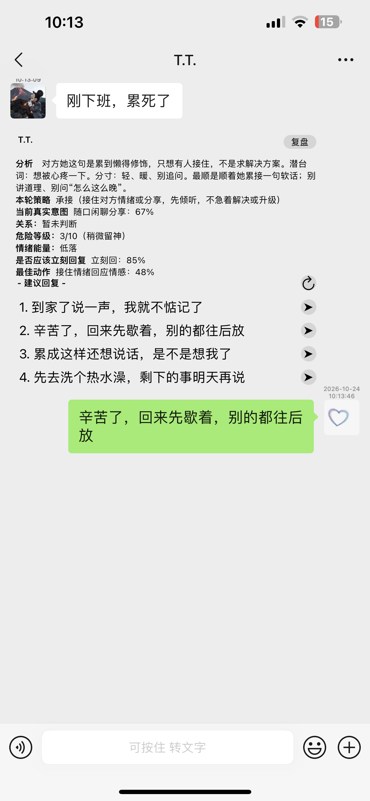 | 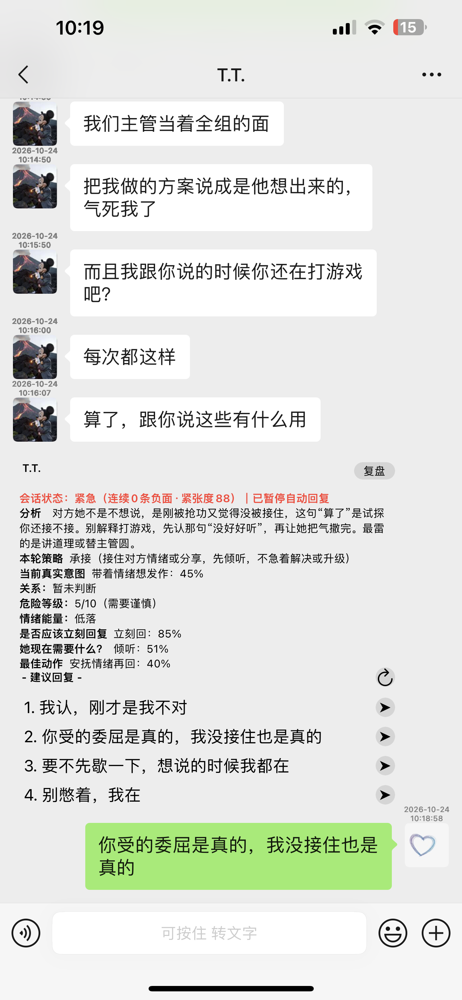 | 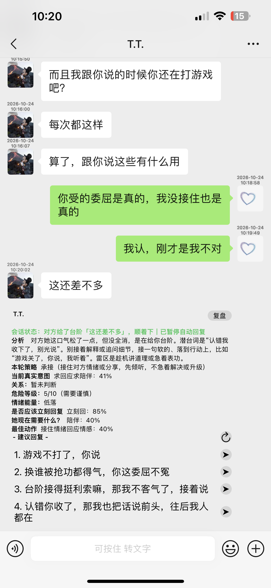 |

### 追求模式 · 祖师爷点评

打开「祖师爷点评」即进入追求模式：卡片只出「深情祖师爷」局评这一块，其余分析、读心、建议回复全部自动让位。点评按童锦程 skill 完整框架推理——摆证据、「这是A不是B」点破、给方向不给台词；无关寒暄自动「跳过」不硬评。

| | |
|:---:|:---:|
| 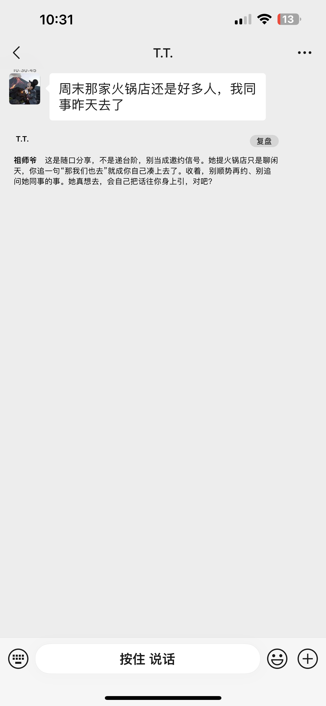 | 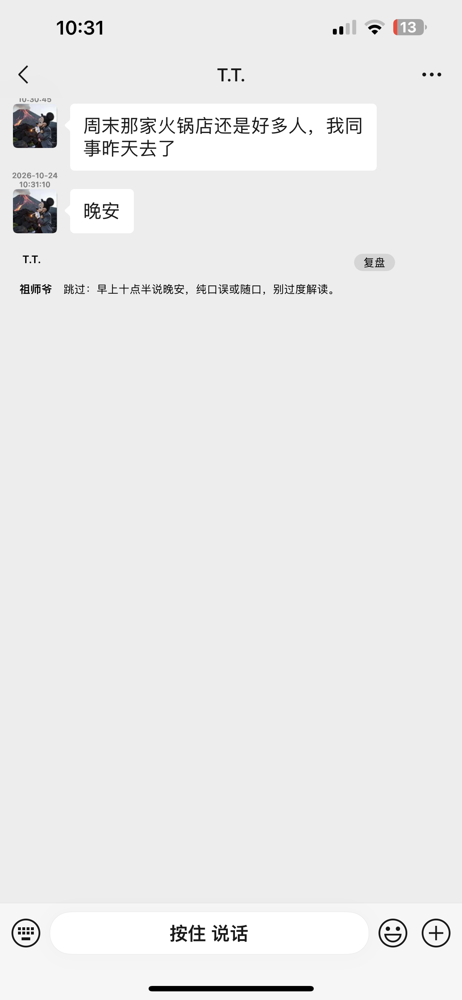 |

### 一键复盘 · 卡住了才点

卡片右上角「复盘」：把整段对话（含你的发言）交给祖师爷全量框架，返回 400 字左右——整体局评、你哪句发坏了、对方心态轨迹、下一步怎么打。

| | | |
|:---:|:---:|:---:|
| 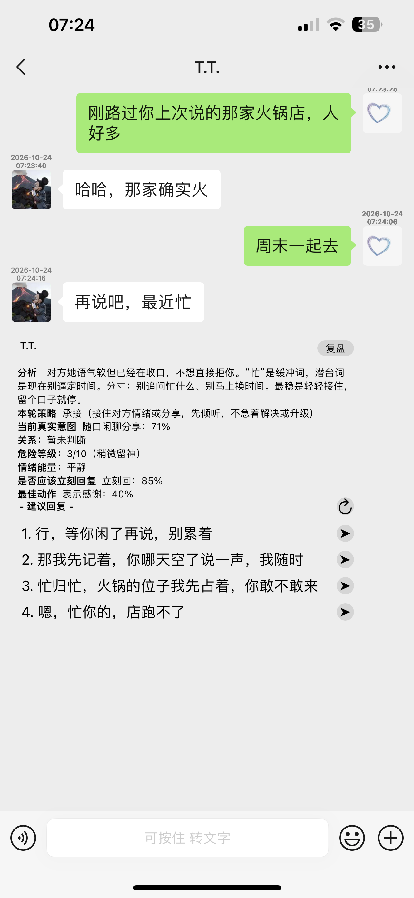 | 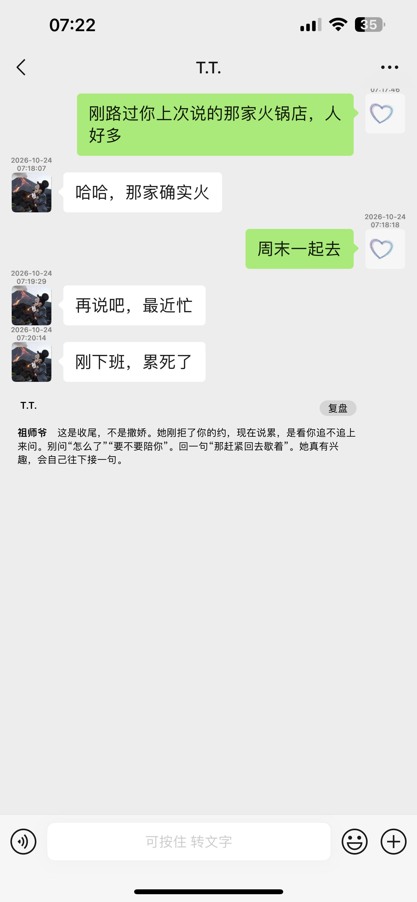 | 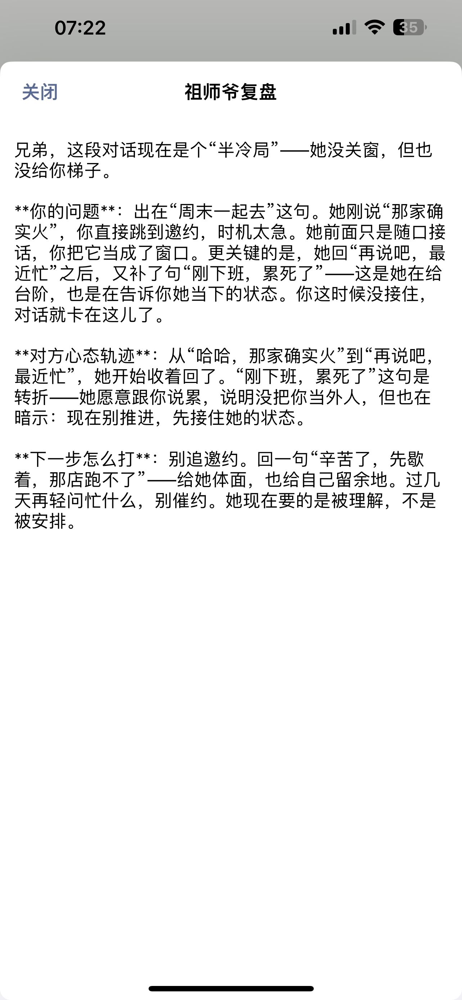 |

### 记忆档案 · 越聊越懂 TA

每位联系人一份会成长的相处笔记：关系定位、长期话题、近期动态、待办承诺……答应对方的火锅和电影，档案都替你记着。

| | | |
|:---:|:---:|:---:|
| 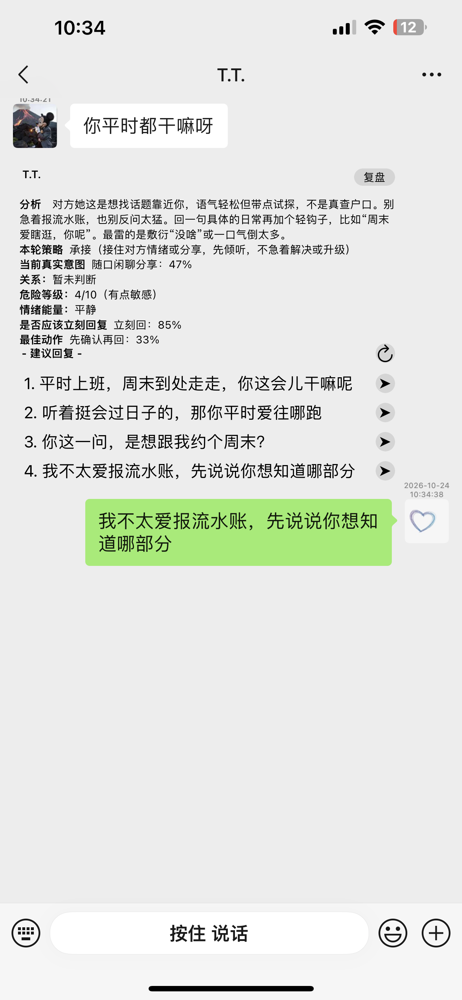 | 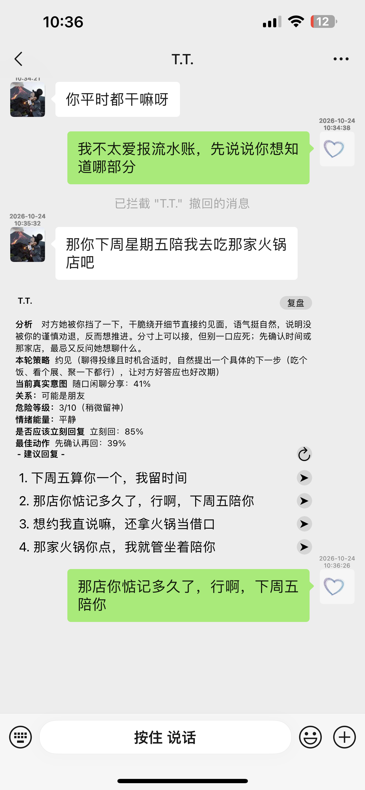 | 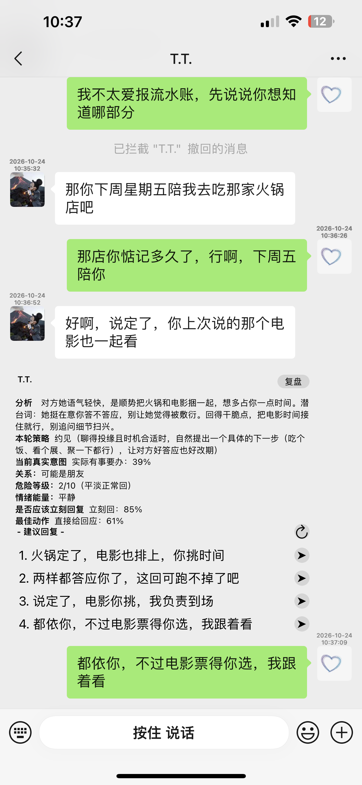 |
| 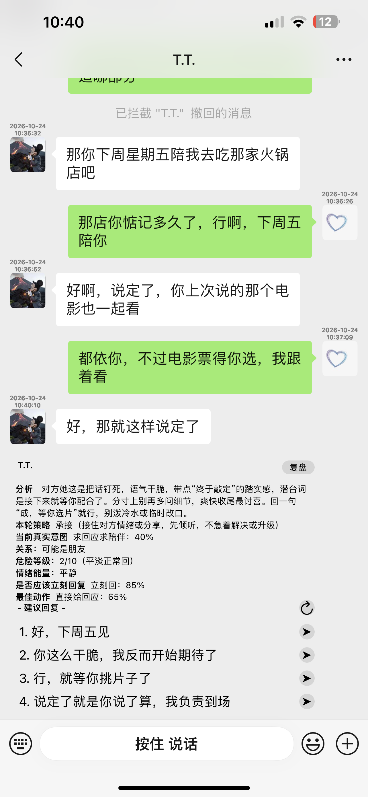 | 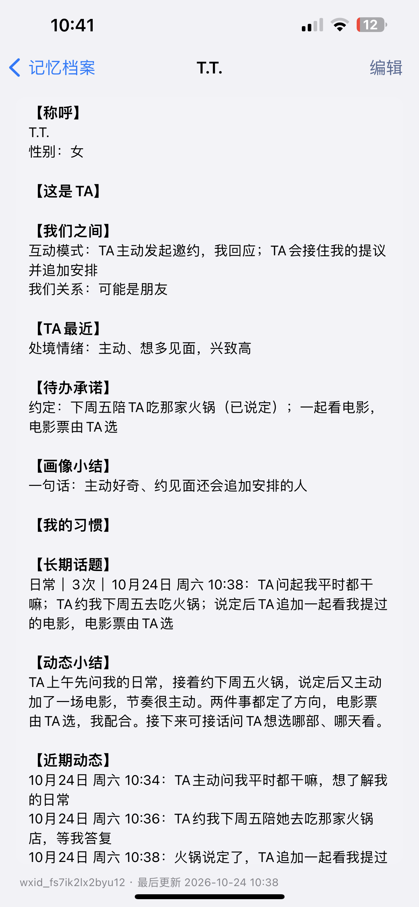 | |

### 设置中心 · 一个入口管全部

微信「我 → 设置 → Jev Chat」，卡片式主页 + 各功能设置页：

| | | |
|:---:|:---:|:---:|
| 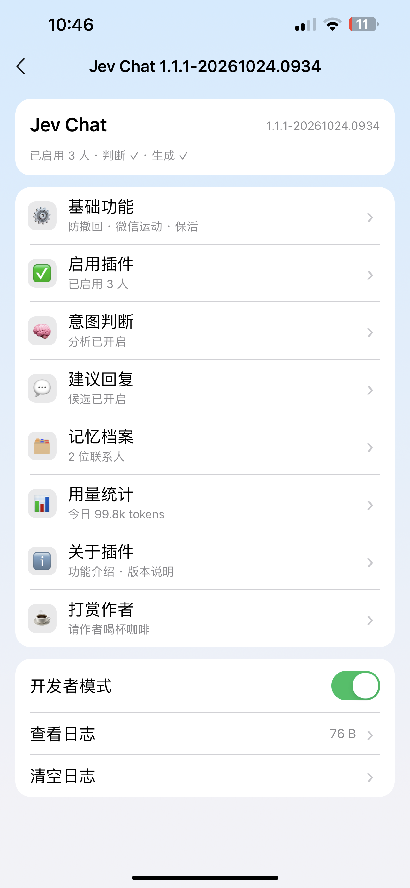 | 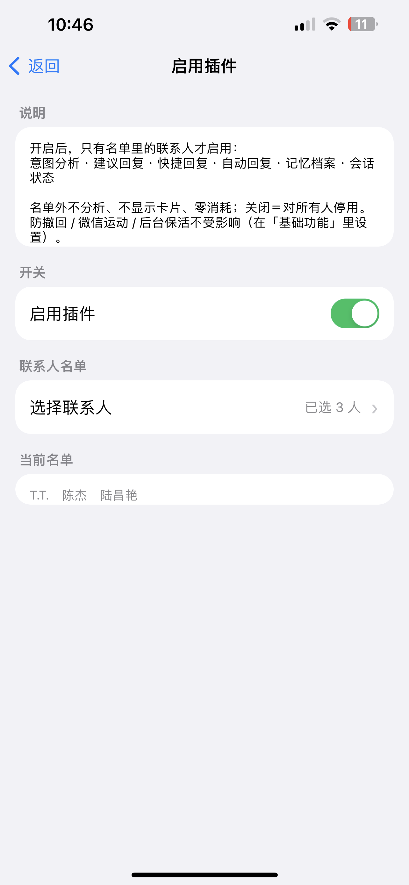 | 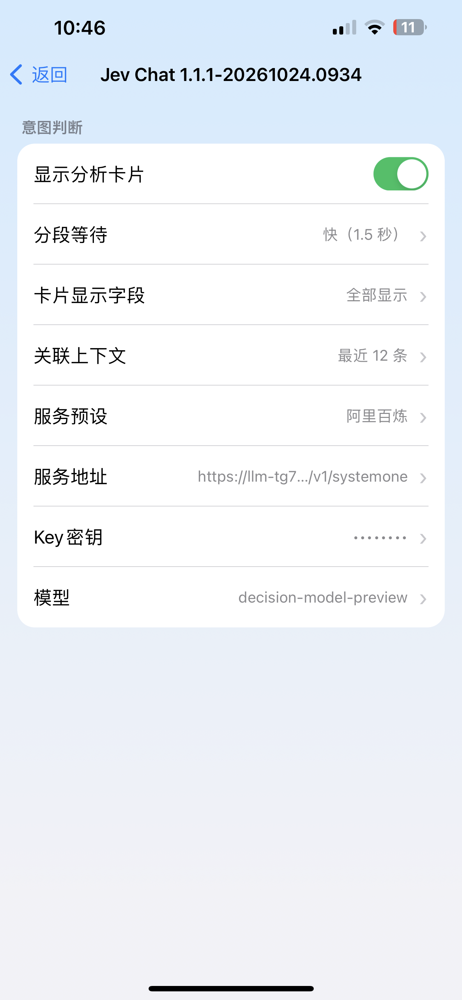 |
| 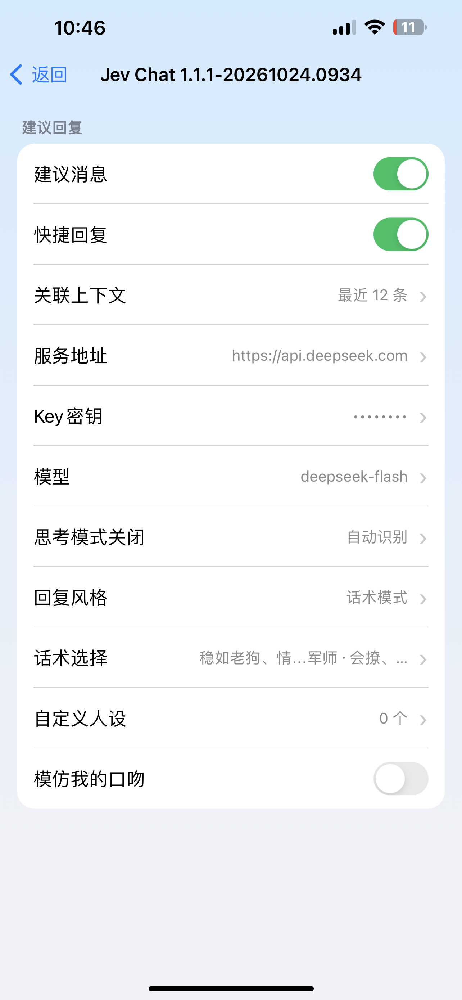 | 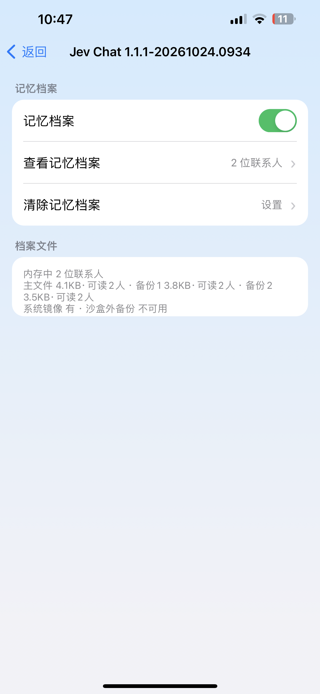 | 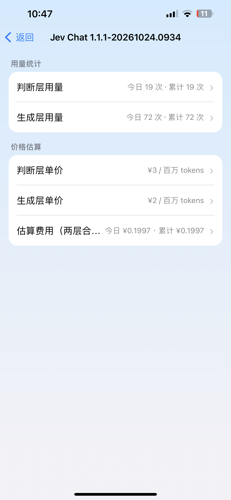 |
| 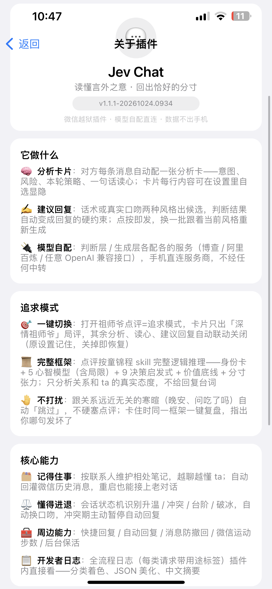 | 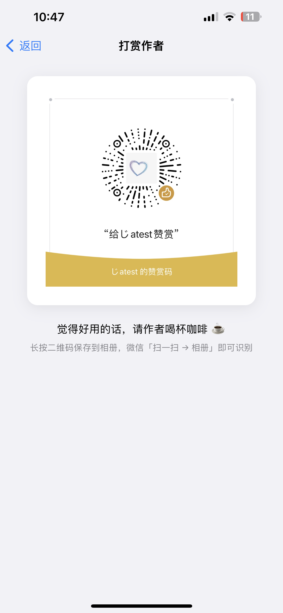 | 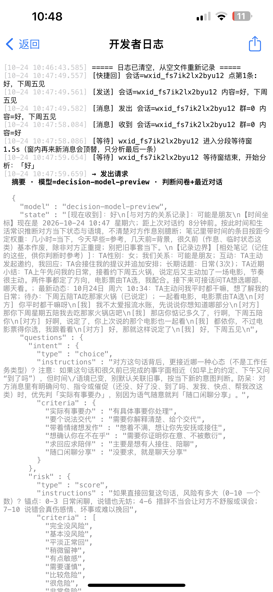 |

---

## ✨ 功能总览

### 📇 启用插件（按联系人白名单）

主页「启用插件」：开关 + 微信原生选人界面（带头像、带搜索、自动回显已选）。名单外联系人不分析、零 token 消耗；开关关闭则分析 / 建议回复 / 记忆 / 自动回复对所有人停用。防撤回 / 微信运动 / 后台保活是全局功能，不受名单影响。

### 🧠 意图分析（判断层）

每条收到的消息经判断层大模型实时分析，以原生样式内嵌在聊天页：

| 卡片内容 | 说明 |
| --- | --- |
| **分析** | 一句话读心：对方此刻状态、情绪与言外之意 |
| **本轮策略** | 承接 / 推进 / 收线等，告诉你这一轮该怎么接 |
| **当前真实意图** | 概率分布，如「想确认你在不在乎：52%」 |
| **关系** | 基于聊天内容与记忆档案自动判断双方关系 |
| **危险等级** | 0–10 分，回错话的代价有多大 |
| **是否应该立刻回复** | 立刻回 / 先想清楚再回，带置信度 |
| **最佳动作** | 这轮最该做的事 |

- **分步上屏**：判断结果先出卡片、读心回来补上、建议回复最后就位——不用等全部就绪才看到卡
- **会话状态机**：跨消息累积「紧张度 + 阶段」——连续冷暴力升级**紧急**、对方给台阶后**刹车**顺着下、跨天没和好再开口进**破冰期**，生成层按态势改口吻；冲突 / 台阶 / 破冰期自动回复暂停，人工拿捏
- **祖师爷点评**（默认关，追求模式总开关）：打开后**自动关掉卡片其它全部开关和建议回复并锁定不可拨**（原设置记住，关掉时恢复+解锁），卡片只出「深情祖师爷」局评这一块，每条消息**只发点评一个请求**——读心、判断问卷（风险/立刻回/最佳动作）、起草候选全停——适合追求 / 被追求场景；推理用童锦程**全量框架**（身份卡 + 5 模型含局限 + 9 启发式 + 价值底线 + 分寸张力，与复盘同一份）；只分析关系不给回复话术，无关消息输出「跳过」不硬评，表达 DNA 男女通用；与判断 / 生成完全隔离
- **历史自动回灌**：重启后内存上下文清空，插件经 sqlite3 只读直读微信消息库，自动把该会话最近约 40 条历史（含以前的记录）补进上下文，老对话也能接上
- 没配判断层 Key 时本地规则兜底（含收线判别），零 token 消耗

### ✍️ 建议回复（生成层）

| 功能 | 说明 |
| --- | --- |
| **4 条候选回复** | 界面**永远固定 4 条**：话术模式按所选人设出（勾 1~4 个话术，依次分配位置、同一话术占多位置时换角度），真实口吻按四档胆量出 |
| **➤ 一键发送 / 🔄 换一批** | 点纸飞机直接发出；换一批先吐备用库存，用完自动重新生成——重生成跟**当前**回复风格走（中途切话术↔真实口吻也同步），连点不叠发请求；生成失败有 toast 提示不再无声 |
| **快捷回复** | 键盘上方常驻建议，不用展开分析卡片 |
| **采纳学习** | 你点选发过的回复被记住（最近 12 条），作为动态示例喂给之后的起草——越用越像你 |
| **不像我（长按）** | 长按建议回复的纸飞机 = 这条口吻不是我：记入起草红线与画像【纠错】层，负反馈与采纳学习互补 |
| **祖师爷复盘** | 卡片右上角「复盘」按钮，手动触发：整段对话（含你的发言）+ 全量祖师爷框架（5 心智模型 + 9 启发式，逐条忠实原 skill）→ 400 字复盘（局评 / 你的问题 / 对方心态轨迹 / 下一步），卡住了才点 |
| **回复风格** | 二选一：**话术模式**=按所选人设出候选（17 种内置可多选 1~4 个 + 自定义人设卡，支持粘贴 SKILL.md 自动清洗）；**真实口吻**=按稳妥 / 敢 / 贴 / 活四档出，不带话术标签，更像随手打字 |
| **模仿我的口吻** | 开启后注入「我的说话习惯」+「我的数字画像」——话术只定方向，落笔像你自己；关掉则完全不学你，人设 / 角度就是全部 |
| **我的数字画像** | 从你跨联系人的发言样本 + 亲自选用的回复中提炼**六层全局画像**（硬规则/身份/表达/决策/人际/纠错），距上次 20 小时自动修订、失败自动冷却不空转，可手改，与「习惯」双层叠加注入 |
| **数字分身语料** | 一键把白名单内聊天记录导出两种文件：jsonl（与运行时请求同构、时间锚用消息自己的 → 百炼 LoRA 微调专属 qwen 小模型）+ markdown 对话材料（→ 电脑端 distilly 蒸馏人设卡贴回插件用）；插件代发的回复自动排除，不污染训练集；页面含步骤引导与费用预估 |
| **自动回复（按联系人）** | 在记忆档案里逐人开启：列表行右侧开关 + 选第 N 条；收线 / 纯应付消息自动不回，判断层不可用时本地关键词兜底；**防连发**：连续消息只回最后一条、10 秒内最多 2 条；代发的回复带标记，不会被当成你的发言学进画像 |

### 🗂 记忆档案（模拟真实社交）

每个联系人一份、随聊天自动成长，也可手动编辑：

| 板块 | 内容 |
| --- | --- |
| 这是TA | 对方的身份、性格、偏好画像 |
| 我们之间 | 关系定位与相处模式 |
| 长期话题 | 反复出现的话题，自动累计次数与最近时间 |
| 近期动态 | 最近 20 条动态（时间自动带星期几） |
| 动态小结 | 大模型每轮重写的近期动态摘要 |
| TA最近 | 对方近期的状态与情绪 |
| 待办承诺 | 答应过的事、待兑现的承诺 |
| 画像小结 | 大模型对 TA 的整体画像提炼 |
| 我的习惯 | 你自己的说话偏好，生成层据此模仿你的口吻 |
| TA的表达习惯 | TA 的句式节奏、称呼你的方式、emoji 与语气（表达 DNA）——生成层用 TA 熟悉的语言密度接话 |
| TA的吵架模式 | TA 吵架的类型/典型表现/不吃哪套——冲突期自动注入，候选不再正撞 TA 的雷 |
| TA的和好方式 | TA 吃哪套台阶、和好信号是什么——台阶期/破冰期自动注入，递 TA 接得住的台阶 |

- **称呼 / 性别自动同步**：优先微信备注、无备注取昵称；性别跟随微信资料，未知则不传给模型
- **增量更新**：每轮对话后节流触发大模型总结，只改变化了的部分，防止误清空
- **「我的习惯」只从有正反馈的发言提炼**：你发出去、对方下一句接住（继续话题 / 反问 / 发表情 / 约下一次）才进习惯，被冷落的说法不学
- **防丢四层保险**：读档三策略解码（新安全格式 / 旧 keyed archive / 早期 plist，老档案自动找回）+ 主文件 + 两代轮换备份 + NSUserDefaults 镜像 + 沙盒外备份
- **单删 / 全清**：列表左滑删一个人，设置里一键清全部

### 🛡 实用增强

| 功能 | 说明 |
| --- | --- |
| **消息防撤回** | 对方撤回消息时拦截并提示「已拦截 XX 撤回的消息」，名字都给你标好 |
| **微信运动步数** | 自定义目标步数，按一天作息平滑渐进 + 每日随机偏移防抖动，数据自然不穿帮 |
| **后台保活** | 场景修复 + 静音循环音频双保险，后台不闪退；物理回前台自动补发微信生命周期通知、**踢一次同步救活长连接**（治「对方发的消息隔好久才收到」）；无悬浮窗、零视觉打扰 |
| **配置迁移** | 一键导出/导入全部设置（含自定义人设卡、负反馈记录、白名单显示名等用户数据）+记忆档案（JSON 文件走分享面板/AirDrop/「文件」App），换机备份一键还原；两阶段校验，坏文件只会被拒收不会弄乱配置 |
| **Key 存 Keychain** | API Key 存系统 Keychain（旧明文自动迁移清除），不进 plist 不进备份；换机带 Key 走「完整导出」 |

### ⚙️ 设置中心

入口：**微信 → 我 → 设置 → Jev Chat**。主页卡片式三段：**头部状态卡**（插件名+版本号+运行状态）/ **图标入口卡**（基础功能 / 启用插件 / 意图判断 / 建议回复 / 记忆档案 / 用量统计 / 关于插件 / 支持作者，带实时副标题）/ **开发者模式小卡**（版本号带构建时间戳，装没装对一眼可见）。

- **双通道 API 独立配置**：判断层、生成层各自的服务地址 / Key / 模型 / 关联上下文条数；判断层服务预设（博查 / 阿里百炼 SystemOne 接入点）一键填入；「分段等待」二选一（标准 3 秒 / 快 1.5 秒）控制出卡速度
- **卡片显示字段**：分析卡片上每类内容（分析 / 祖师爷 / 本轮策略 / 当前真实意图 / 关系 / 危险等级 / 情绪能量 / 是否立刻回 / 最佳动作等）独立选显隐，默认全显；会话状态、祖师爷点评开关也收在这页（关=连请求一起停）；**祖师爷点评=追求模式总开关：开时其余开关和建议回复联动全关（原设置记住），关时恢复**，入口行值显示「追求模式中」；改完回聊天界面已显示的卡片自动同步
- **生成层思考模式关闭**：按服务商八选一（自动识别 / 百炼 / GLM / 豆包 / OpenAI / OpenRouter / Gemini / vLLM），填错会变慢多花钱
- **用量统计**：判断层 / 生成层分开的今日与累计 token 用量，可一键清零；**价格估算**：两层单价自填（元/百万 tokens），自动算今日/累计费用（缓存命中实际更便宜，估算偏保守）
- **开发者模式**（默认关）：开 = 全流程调试日志写沙盒 `Documents/jevchat.log`——各请求带用途标签（judge·意图判断 / gen·读心 / gen·祖师爷点评 / gen·起草候选 / gen·记忆更新 / gen·复盘），回灌含拉回的每条消息内容，分段等待窗有始末；主页「查看日志」进入**插件内阅读器**（分类着色 + JSON 美化 + 中文摘要，每步干了什么直接读懂）并可分享导出；超 2MB 自动轮转。内置**运行监控**：崩溃现场（信号 + 调用栈，总落盘）、主线程卡顿（≥3 秒）、下次启动体检上次会话是否异常结束
- **关于插件 / 支持作者**：插件自我介绍（分节排版）；打赏二维码 + 作者微信二维码都内嵌插件，轻点直接跳转（收款码跳打赏、个人码跳加好友），长按保存到相册

---

## 🧠 工作流程

### 分析与回话主链路

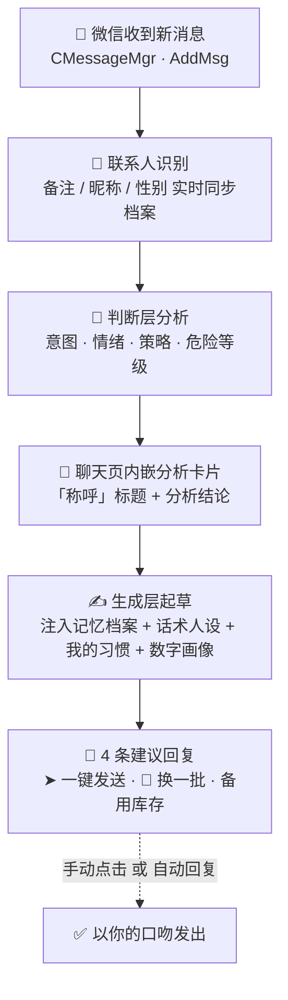

### 记忆档案闭环

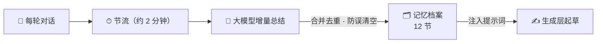

> 聊得越多 → 档案越厚 → 回复越像你、越懂 TA。

### 一条消息的大模型请求（全开时）

| 请求 | 时机 | 说明 |
| --- | --- | --- |
| ① 真人读心 | 收到消息即发，与②并行 | 追求模式下换成祖师爷点评（二选一） |
| ② 意图判断 | 同步等结果 | 判断层没配 Key 走本地规则（0 请求） |
| ③ 记忆重写 | 节流窗合并后异步 | 同会话约 2 分钟内多条消息只重写一次 |
| ④ 起草候选 | 判断完成后 | 一次要回 8 条挑 4 条；失败本地模板兜底 |
| ⑤ 画像提炼 | 约 20 小时一次 | 失败 20 分钟冷却，不重复空转 |

---

## 📦 安装

| 项目 | 要求 |
| --- | --- |
| 系统 | iOS 14+（arm64 / arm64e） |
| 注入 | 越狱 Sileo/Zebra 装 `.deb`，或巨魔注入器直接注入 dylib，均可 |
| 作用域 | 仅注入微信（com.tencent.xin），不碰其他 App |

> dylib 内置 ObjC hook 引擎，**不依赖 rootful 路径的 CydiaSubstrate**：rootful / rootless / roothide（RootHide）/ 巨魔注入器链路一个包通用（iOS 14+ 通用，v1.1.1-20261025 起）。装完重启微信，在 **微信 → 我 → 设置** 里找到「Jev Chat」入口，填入你的 API 地址、Key 与模型即可开始。

> 📖 每一项怎么填、怎么用，见 **[使用与配置说明](Docs/使用说明.md)**：聊天界面说明、判断层服务预设、生成层思考模式对照表、记忆档案操作、常见问题。

## 🛠 从源码编译

```bash
git clone https://github.com/ray/Jev-Chat-for-WeChat.git
cd Jev-Chat-for-WeChat

# 需要 Theos 环境（https://theos.dev）
THEOS=~/theos make package

# 产物位于 packages/me.ray.jev-chat_*.deb
```

---

## 🧩 实现原理

不依赖任何微信头文件，全部运行时动态解析 + 异常兜底，微信小版本更新不易失效：

| Hook / 模块 | 作用 |
| --- | --- |
| `CMessageMgr · AddMsg:MsgWrap:` | 消息入口，触发判断层与生成层 |
| `MMContext → CContactMgr · getContactByName:` | 读取联系人备注 / 昵称 / 性别 |
| 撤回 sysmsg 通知 | 拦截撤回，提示发送者名字 |
| `WCDeviceStepObject · m7StepCount` | 微信运动步数注入 |
| Scene / UIApplication / UNCenter | 后台保活 + 场景修复 + 回前台踢同步 |
| 消息 Cell + Associated Objects | 原生样式内嵌分析卡片与建议回复 |

所有大模型请求统一走「system 规则 + user 数据」双角色结构（静态提示词进 system 提升遵从度并利于服务商前缀缓存），OpenAI 兼容与 Anthropic 两种接口都支持。

<details>
<summary><b>📁 目录结构</b></summary>

```
Jev-Chat-for-WeChat
├── WIA.h              // 公共常量 / 接口声明（含设置页家族类壳）
├── WIAInternal.h      // 文件拆分后的内部跨文件符号（hidden，不对外导出）
├── WIACore.xm         // 入口+总调度：全局/配置/Keychain/日志/白名单 + RunAnalysis + %ctor
├── WIANet.mm          // 网络层（PostJSON/URL 构造）+ 用量统计
├── WIAJudge.mm        // 判断层（SystemOne/Chat）+ 规则兜底
├── WIAGen.mm          // 生成层起草 + 候选后处理 + 换一批 + 采纳学习 + 画像提炼
├── WIAHistory.mm      // 会话内存历史 + 微信库回灌读取 + 语料导出
├── WIAMemory.mm       // 记忆档案 + 会话状态机
├── WIAPrompts.xm      // 提示词与话术人设（调教只动这个文件）
├── WIAUI.xm           // 流程与 hook：消息接收数据层 + 发送/自动回复/观察者
├── WIACardRender.mm   // 卡片渲染：公共测量 + 容器构建 + 富文本组装 + 渲染缓存
├── WIAUIRefresh.mm    // 刷新工具：可见刷新 / 贴底跟随 / 行高重算
├── WIASettings.xm     // 设置入口 hook + 共享构建器 + 通用助手
├── WIASettingsVC.mm   // 设置中心 WIAXiaoweiVC 四页 + 配置导入导出(B3)
├── WIAMainPages.mm    // 主页 WIAMainVC + 关于 + 打赏（双二维码）+ 日志查看
├── WIAMemoryPages.mm  // 记忆档案查看：联系人列表 + 笔记详情
├── WIAContactPages.mm // 联系人选择 / 启用插件 / 卡片显示字段
├── WIAPersonaPages.mm // 话术选择器 + 自定义人设 + 我的数字画像
├── WIAFeatures.xm     // 防撤回 / 微信运动步数
├── WIAPreserve.xm     // 后台保活（场景修复 + 静音音频 + 回前台踢同步）
├── WIAHookCompat.m    // 内置 ObjC hook 引擎（不依赖 CydiaSubstrate，各链路通用）
├── WIAWatchdog.xm     // 运行监控（主线程卡顿 / 崩溃信号 / 启动体检）
├── FloatingButtonWindow.*  // 保活音频引擎
├── CustomToastView.*       // 提示 UI
├── WIADonateImage.c   // 打赏二维码原图（内嵌二进制）
├── WIAMyQRImage.c     // 作者微信二维码原图（内嵌二进制）
├── Jev-Chat.plist     // 注入过滤（仅微信）
└── Docs/              // 使用说明与截图素材
```

</details>

---

## 🗓 近期更新亮点

**稳定性与性能（第七十六轮·全项目审查修复 44 项）**
- 保活回前台判定改正向白名单匹配，长连接救活不再偶发失效；换一批空槽模板补齐，**任何情况界面恒 4 条**
- 话术配置统一清洗（冷启动/导入/选择页/同步四写点共用），堵死导入脏数据导致的分析失败链
- 画像提炼失败自动冷却+并发互斥（不再每条消息空转扫描）；自动回复带 bot 标记，AI 的话不再被当成你的发言学进画像
- 卡片渲染按指纹缓存 + 刷新通知去抖（每条消息主线程全树遍历降大半）；热路径 formatter 静态缓存
- 静音音频失败熔断+被抢占指数退避；候选解析剥 markdown 符号/CRLF 隐形字符；emoji 代理对安全截断
- 配置导出补齐自定义人设卡/负反馈/白名单显示名/画像时间等用户数据键；iOS 14 崩溃 API 修复

**卡片与界面**
- 分析卡片单行制精简：每个判断块一行（标签 + 结论 / 概率），全功能开启不撑屏，信息零损失；深浅模式即时跟随；修复左滑返回手势反复滑动导致的界面跳动
- 设置主页新增「关于插件」「打赏作者」（打赏码+作者微信码双二维码内嵌插件，长按存相册）；版本号带构建时间戳

**祖师爷体系（人设视角）**
- 祖师爷点评：追求模式总开关——打开后卡片只出人设视角局评一块（童锦程骨架），其余卡片开关和建议回复联动关闭（原设置记住、关闭时恢复），默认关
- 祖师爷复盘：卡片右上角手动触发，整段对话 + 全量框架（5 心智模型 + 9 启发式，逐条忠实原 skill）→ 400 字复盘，指出你自己哪句发坏了
- 话术新增「深情祖师爷」+「·抽离」变体（专治冷淡敷衍），并支持**自定义人设**：自己写人设卡，保存即入「话术选择」

**数字化的自己（D 系列 + distilly 方法论）**
- 我的数字画像（D-1）：跨联系人发言样本 + 采纳回复 → 自动提炼**六层画像**（硬规则/身份/表达/决策/人际/纠错，distilly 结构），与「我的习惯」双层注入；20h 节流自动更新、可手改
- 「不像我」负反馈（B）：聊天页**长按建议回复的纸飞机** = 这条口吻不是我——记入起草红线与画像【纠错】层，与采纳学习（正向）互补
- TA 的深度画像（A，distilly relationship 框架）：记忆档案新增 TA的表达习惯/吵架模式/和好方式三节；**会话状态机 × 档案组合拳**——冲突期自动带上 TA 的吵架模式（别撞雷），台阶期/破冰期带上 TA 的和好方式（递对台阶）
- 数字分身语料（D-3）：聊天记录一键导出两种文件——与运行时请求同构的 **jsonl**（百炼 LoRA 微调专属 qwen 小模型）+ **markdown 对话材料**（电脑端 Claude Code + distilly 蒸馏完整人设卡）
- 人设卡互导（C）：自定义人设页「粘贴清洗」一键剥 SKILL.md 的 frontmatter/元数据，distilly 社区 200+ 人设卡直接变插件话术

**引擎与请求**
- 全链路 system/user 重构：读心 / 点评 / 复盘 / 记忆更新静态规则进 system（遵从度更高、利于前缀缓存），统一请求通道，顺带补齐 Anthropic 生成层支持与思考型模型专项报错
- 判断层普通模型路径补齐关系 / 相处笔记 / 时间坐标注入（与 SystemOne 路径同源）

**记忆与状态**
- 记忆档案防丢四层保险 + 三策略读档，老档案自动找回；「我的习惯」只从对方接住的发言提炼
- 会话状态机：升温→冲突→紧急升级、台阶期刹车、跨天破冰期；冲突期自动回复暂停、未和解档案跨重启保留可手动「已和好」
- 按联系人白名单启用 + 自动回复逐人开关；判断层不可用时本地关键词兜底
- 判断层服务预设（博查 / 阿里百炼 SystemOne）与生成层思考模式八选一；422 自动降级重发

<details>
<summary><b>查看完整更新日志</b></summary>

完整迭代记录见 git 提交历史（每轮优化独立成提交）。

</details>

---

## ⚠️ 免责声明

- 本项目**仅供学习与技术研究**，请勿用于任何违反法律或平台规则的场景；
- 需自备大模型 API（OpenAI 兼容接口），所有请求直接从设备发往你配置的服务地址，本项目不收集任何数据；
- AI 生成的内容可能不恰当，发送前请自行判断；与人相处，真诚永远是最好的话术。

---

<div align="center">

**如果这个项目帮到了你，点个 ⭐ Star 让更多人看到**

</div>
