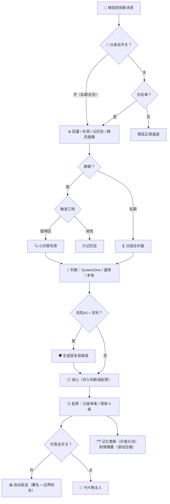

<div align="center">

# 💬 Jev-Chat for WeChat

### 微信 AI 高情商回话助手 · 个人分身 · iOS 越狱插件

收到消息的一瞬间，聊天页里自动浮现一张**意图分析卡片**——
对方在想什么、情绪如何、该不该立刻回、怎么回最合适，一目了然；
并附上 **4 条像你自己说话的建议回复**，点击 ➤ 直接发送。

为每位联系人维护一份会成长的**记忆档案**，为群里每个发过言的人自动建立**群员画像**。
开着**个人分身**，睡觉了它替你值守——按你的作息、你的画像、你的边界刹车，代答那些该答的消息。

[]()
[]()
[]()
[]()
[]()

</div>

---

## ✨ 功能总览

### 🔐 授权体系

**未授权（免费）**：判断 + 建议回复基本链（卡片 / 4 条候选 / 发送 / 换一批）、自动回复、记忆档案、祖师爷点评 / 复盘 / 追求模式、会话状态、保活 / 防撤回 / 步数。

**授权解锁（RSA-2048 验签，绑定微信 ID）**：群聊全体系（group）· 联系人自定义规则（contact_rules）· 主题皮肤（theme）· 候选改后发送（edit_reply）· 关系统计（stats）· 高危双判（double_judge）· 判断对比测试（ab_compare）· 我的分身（buddy）· 配置备份（backup）。授权文件 `.wiaauth` 由 Mac 签发工具按微信 ID 生成，导入即验即用。

### 📇 启用插件（白名单）

联系人与群分开管理：开关 + 微信原生选人界面（带头像、搜索、自动回显）。名单外零 token 消耗；总开关关闭则分析 / 建议回复 / 记忆 / 自动回复对所有人停用。防撤回 / 微信运动 / 后台保活是全局功能，不受名单影响。

### 🤖 我的分身（授权 buddy）

睡觉了，它替你值守。三个开关各管一层：

| 开关 | 管什么 |
| --- | --- |
| **分身总开关** | 白名单外的人：出卡片、判断、建档 |
| **代答总开关** | 自动回复总闸——开 = 按分身画像代答；关 = 只出卡不代答 |
| **陌生人代答** | 单独控制白名单外的人是否被自动回复 |

- **作息引擎**：出站消息按小时自动学你的睡眠窗口（双滚轮可手改）；窗口内切深夜值守腔、窗口外正常腔——**只切口吻，不影响发不发**
- **分身画像**：六层蒸馏结构（硬规则 / 身份节奏 / 表达 / 决策 / 人际 / 纠错）+【备注·我的职业】，生活规律全覆盖；**代答时高于一切**；可编辑、可让大模型按近期对话微调
- **分身署名**：每条代答消息第二行附「——AI回复」（文字可编辑 / 清空不附）
- **边界刹车**（硬规则）：钱 / 承诺 / 邀约 / 健康 / 风险≥5 一律不代答，转待主理队列
- **待主理队列**：醒来集中看「哪些已代答、哪些等你回」
- **悬浮球**：可拖动圆球（蓝=代答开 / 红=关），点按切换代答总开关；静置 5 秒自动收成贴边粗竖线

### 🧠 意图分析（判断层）

每条收到的消息经大模型实时分析，以原生样式内嵌聊天页：

| 卡片内容 | 说明 |
| --- | --- |
| **分析（读心）** | 一句话读心：对方此刻状态、情绪与言外之意 |
| **本轮策略** | 承接 / 推进 / 收线等，告诉你这一轮该怎么接 |
| **当前真实意图** | 概率分布，如「想确认你在不在乎：52%」 |
| **关系 / 危险等级 / 情绪能量 / 是否立刻回 / 最佳动作** | 全维度局面速览 |
| **高危双判**（授权） | 风险 ≥5 时生成层模型复核，取两者较高值 |

- **SystemOne 专用网关**：阿里百炼预设一填即用，逐题问卷 0.2~0.4 秒出结果，每题带概率与置信度
- **读心不跑偏**：判断出结论再读心，不许推翻定论；省流开=读心随判断或起草一起回
- **第二意图候选**：意图第二可能 ≥15% 时末 2 条候选按它写，一套候选接住两种局面
- **上下文带时间**：行级时间戳，分得清当下与旧账；16k 封顶丢最旧
- **规则直进快车道**：联系人/群自定义规则收编进 SystemOne state
- **高危双判 / 判断对比测试**（授权）
- **采纳反馈进判断**：你选过的候选作分寸参考回流判断层
- 没配判断层 Key 时本地规则兜底，零 token

### ✍️ 建议回复（生成层）

| 功能 | 说明 |
| --- | --- |
| **4 条候选回复** | 话术模式（17 种人设 + SKILL.md 清洗）/ 真实口吻（四档胆量） |
| **➤ 发送 / ✏️ 改后发（授权）/ 🔄 换一批** | |
| **采纳学习 / 不像我** | 正负反馈双通道 |
| **模仿我的口吻** | 六层画像 + 说话习惯，20h 自动修订 |
| **数字分身语料** | jsonl + markdown 一键导出 |
| **自动回复（按人 / 按群）** | 防连发 10 秒 2 条；代发带 bot 标记 |

### 👥 群聊体系（群类型化，授权）

5 类群型 / 群笔记按类型建档 / 业务知识只读节 / 触发三档 / 群自定义规则 5 套模板 / 群员画像逐人建档 / 按群自动回复。

### 🗂 记忆档案

12 节相处笔记 + 【备注】手写事实节（模型只读）。记忆按价值分流、前情摘要滚动压缩、分身代答期间不写笔记。防丢五层保险。

### 🛡 实用增强

消息防撤回 / 微信运动步数 / 后台保活 / 配置迁移（含群员画像与前情摘要）/ Key 存 Keychain / 运行监控。

---

## 🔄 工作流程



---

## 🧪 判断方式实测（2026-10）

| | 百炼 SystemOne | 百炼通用 qwen3.8-max | 全 DeepSeek deepseek-flash |
| --- | --- | --- | --- |
| 判断耗时 | **0.2~0.4 秒** | 2.0 秒 | 1.1 秒 |
| 判断输入 | ~1318 token | ~470 token | ~450 token |
| 候选联动 | **最强** | 中 | 中 |

**结论：要最准 = 百炼 SystemOne + deepseek-flash；要省事 = 全 deepseek-flash。** 完整对比见 [Docs/使用说明.md](Docs/使用说明.md)。

---

## 📦 安装

| 项目 | 要求 |
| --- | --- |
| 系统 | iOS 14+（arm64 / arm64e） |
| 注入 | 越狱 Sileo 装 `.deb`，或巨魔注入 dylib |
| 作用域 | 仅微信（com.tencent.xin） |

装完重启微信，主页有「📖 使用说明」。

## 🛠 从源码编译

```bash
git clone <repo>
cd Jev-Chat-Auth
THEOS=~/theos make package     # packages/me.ray.jev-chat_*.deb + Jev-Chat.dylib
```

---

## 🧩 实现原理

不依赖微信头文件，全部运行时动态解析 + 异常兜底。27 个源文件各司其职：

| 核心 | 作用 |
| --- | --- |
| `WIACore.xm` + `WIAPipeline.mm` | 管线编排（判断/双判/读心/起草阶段化） |
| `WIAJudge.mm` | SystemOne 问卷 / 通用 chat / 本地兜底 |
| `WIAGen.mm` | 起草 + 分身单条 + 换一批 + 画像 |
| `WIABuddy.mm` | 分身（作息/监控/代答/刹车/待主理/悬浮球） |
| `WIAHistory.mm` | 行级时间历史 + 回灌 + 前情摘要 |
| `WIABuddy.mm` | 分身独立模块（作息/代答/刹车/悬浮球） |

<details>
<summary><b>📁 完整目录结构</b></summary>

```
Jev-Chat-Auth
├── WIA.h / WIAInternal.h     // 公共接口 + 跨文件符号
├── WIACore.xm                // 管线编排 + 规则契约 + 配置同步
├── WIAPipeline.mm            // 端到端总调度（判断/双判/读心/起草阶段化）
├── WIAUI.xm                  // 消息 Hook：合并窗 / 三档触发 / 代答发送
├── WIAJudge.mm               // 判断层（SystemOne/Chat）+ 双判 + 本地兜底
├── WIAGen.mm                 // 起草 + 分身单条 + 换一批 + 画像
├── WIAPrompts.xm             // 提示词层
├── WIANet.mm                 // 唯一 HTTP 出口 + 用量统计
├── WIAHistory.mm             // 历史(LRU) + 回灌 + 前情摘要 + 群员画像
├── WIAMemory.mm              // 档案五层持久化 + 状态机 + 群节结构
├── WIACardRender.mm          // 卡片渲染 + 语义色
├── WIAUIRefresh.mm           // 刷新去抖 / 贴底跟随 / 键盘避让
├── WIASettings.xm            // 入口 hook + 渐变基建
├── WIASettingsVC.mm          // 设置中心五页 + 导入导出
├── WIAMainPages.mm           // 主页 / 关于 / 使用说明 / 日志
├── WIAMemoryPages.mm         // 记忆档案 + 联系人规则 + 统计入口
├── WIAGroupNotesPages.mm     // 群笔记 + 群员档案查看页
├── WIAContactPages.mm        // 白名单 / 群自定义 / 卡片字段
├── WIAPersonaPages.mm        // 话术 / 人设 / 画像 / 语料
├── WIACompare.mm             // 判断对比测试页
├── WIAStats.mm               // 关系统计
├── WIABuddy.mm               // 我的分身（独立模块）
├── WIAFeatures.xm            // 防撤回 / 步数
├── WIAPreserve.xm            // 保活
├── WIAWatchdog.xm            // 运行监控
├── WIAAuth.mm                // RSA-2048 授权验签（17 功能键）
├── WIATheme.mm               // 主题引擎
├── FloatingButtonWindow.m    // 保活静音音频（原版 ImmortalizerJailed）
├── CustomToastView.m         // 吐司（同源）
└── Jev-Chat.plist            // 注入过滤（仅微信）
```

</details>

---

## 🗓 近期更新

<details open>
<summary><b>我的分身 + 前情摘要 + 悬浮球（本批）</b></summary>

- **我的分身（授权 buddy）**：免白名单监控所有私聊、作息引擎自动学睡眠窗口、代答总开关（自动回复总闸）、六层蒸馏分身画像（独立可编辑、可选大模型按近期对话修订，代答时高于一切）、边界刹车（钱/承诺/邀约/健康/风险≥5 不代答）、待主理队列；分身代答只出一条且不进记忆档案；分身署名第二行可编辑；悬浮球可拖动/贴边停靠/点按切换
- **前情摘要**：长对话掉出窗口的行自动压缩成每会话 ≤400 字摘要，注入判断与起草；分身睡眠窗口内夜间归档
- **判断增强（授权）**：高危双判（风险≥5 复核取高值）；判断对比测试页
- **群员画像（授权 group）**：逐人建档注入判断/起草；查看/删除页面；随配置迁移
- **候选**：第二意图候选占末 2 槽；读心禁出例句；候选可编辑再发
- **上下文**：行级时间戳；跨设备补洞；采纳反馈进判断层
- **省流**：读心并入起草；记忆按价值分流
- **文档**：README / 使用说明 / 关于插件 / 插件内使用说明四层全面重写

</details>

<details>
<summary><b>历史里程碑</b></summary>

- 群聊体系：5 类群型 / 触发三档 / 群笔记按类型 / 业务知识只读 / 群员画像
- 卡片全彩晕染 + 五款皮肤 + 主题五色
- 祖师爷体系：追求模式 + 复盘
- 数字分身：六层画像 / 采纳学习 / 负反馈 / 语料导出
- 会话状态机：冲突刹车 / 台阶 / 破冰
- 授权体系：RSA-2048 / 17 功能键 / Mac 签发工具
- 两轮真机全链路实测（百炼 SystemOne / DeepSeek 双通道）
- 全项目审查修复 60+ 项稳定性与性能问题

</details>

---

## ⚠️ 免责声明

- 本项目**仅供学习与技术研究**，请勿用于任何违反法律或平台规则的场景；
- 需自备大模型 API，所有请求直接从设备发往你配置的服务地址，本项目不收集任何数据；
- AI 生成的内容可能不恰当，发送前请自行判断；与人相处，真诚永远是最好的话术。

---

<div align="center">

**如果这个项目帮到了你，点个 ⭐ Star 让更多人看到**

</div>
