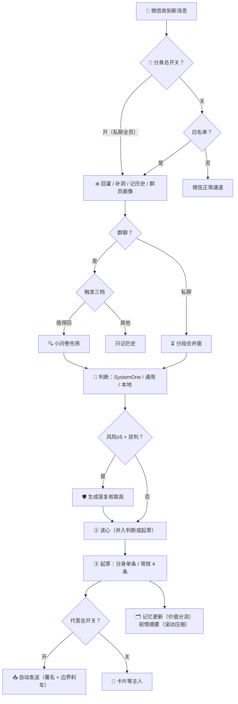

<div align="center">

# 💬 Jev-Chat for WeChat

### 微信 AI 高情商回话助手 · 个人分身 · iOS 越狱插件

收到消息的一瞬间，聊天页里自动浮现一张**意图分析卡片**——
对方在想什么、情绪如何、该不该立刻回、怎么回最合适，一目了然；
并附上 **4 条像你自己说话的建议回复**，点击 ➤ 直接发送。

为每位联系人维护一份会成长的**记忆档案**，为群里每个发过言的人自动建立**群员画像**。
开着**个人分身**，睡觉了它替你值守——按你的作息、你的画像、你的边界刹车，代答那些该答的消息。

[]()
[]()
[]()
[]()
[]()

**📖 完整手册（按免费 / 授权分册）见 [Docs/使用说明.md](Docs/使用说明.md)**

</div>

---

## ✨ 一屏看懂

| | |
|:---:|:---|
| 🧠 **意图分析卡片** | 每条消息实时配卡：真实意图概率、风险等级、本轮策略、一句话读心——百炼 SystemOne 预设实测 **0.2~0.4 秒**出结果 |
| ✍️ **4 条建议回复** | 话术模式（17 种人设）/ 真实口吻（四档胆量），模仿你的六层数字画像；点 ➤ 发送、🔄 换一批 |
| 🗂 **记忆档案** | 每位联系人 12 节相处笔记自动成长，【备注】写死的事实模型只读必守；隔半小时回归自动补上电脑端聊的中段 |
| 🤖 **我的分身** | 睡觉了它替你值守：免白名单监控私聊、按作息窗口代答、六层分身画像、边界刹车、待主理队列、悬浮球 |
| 👥 **群聊全体系** | 群类型五选一、触发三档、群笔记业务知识、群员画像逐人建档、按群自动回复 |
| 🛡 **实用增强** | 后台保活（双层：音频防冻结 + 拦截挂起清理）· 消息防撤回 · 消息时间常显 · 微信运动 |

---

## 🆓 免费功能（永不过期）

| 能力 | 说明 |
| --- | --- |
| 🧠 **判断 + 建议回复基本链** | 分析卡片、4 条候选、➤ 发送、🔄 换一批——核心永不过期 |
| 🤖 **自动回复** | 按人 / 按群开关 + 第 N 条；收线、应付消息自动不回 |
| 🗂 **记忆档案** | 12 节相处笔记 + 【备注】，自动成长可手编 |
| 🧿 **祖师爷** | 卡片局评（追求模式）+ 400 字整段复盘 |
| 🌊 **会话状态** | 冲突刹车 / 台阶 / 破冰期，自动暂停自动回复 |
| 🛡 **基础四件** | 后台保活 · 消息防撤回 · 消息时间常显 · 微信运动 |

## 🔑 授权解锁

| 功能键 | 功能 | 入口 |
| :---: | --- | --- |
| `group` | **群聊全体系** | 启用插件 → 选择群聊 |
| `contact_rules` | **联系人自定义规则** | 记忆档案 → 联系人 → 规则 |
| `theme` | **主题 / 卡片皮肤** | 外观 |
| `edit_reply` | **候选改后发送** | 卡片上点候选文字 |
| `stats` | **关系统计** | 记忆档案右上「统计」 |
| `double_judge` | **高危双判** | 意图判断 → 判断增强 |
| `ab_compare` | **判断对比测试** | 意图判断 → 判断增强 |
| `backup` | **配置备份** | 主页 → 配置迁移 |
| `buddy` | **我的分身**（全员监控 + 睡眠代答 + 分身画像 + 悬浮球） | 主页 → 我的分身 |

> **授权期 365 天。购买流程**：① 先跑通插件「一键自检」（判断 + 建议回复必须能用）→ ② 复制微信 ID + 付款 → ③ 授权文件 `.wiaauth` **8 小时内**发出，导入即验即用（RSA-2048 验签，绑定微信 ID）。
> 问使用教程的不包教，只包插件更新；有 bug 欢迎反馈（微信版本 / 插件版本 / 装的所有插件 / 截图）。

---

## 🚀 快速上手

```text
① 安装并重启微信
② 微信 → 我 → 设置 → Jev Chat
③ 意图判断页 + 建议回复页各配一层 API（推荐见下方「模型推荐」）
④ 启用插件 → 开总开关 → 勾联系人；群在「选择群聊」里勾
⑤ 回主页点「一键自检」，无报错即成功 → 聊天页收到消息即可看到卡片
```

> 💡 只配生成层也能用（判断走本地规则兜底，零 token）；两层可填同一家。

---

## 🏆 模型推荐（实测组合）

| 层 | 推荐 | 配置 | 说明 |
| --- | :---: | --- | --- |
| 🧠 判断层 | ⭐ **阿里百炼** | 预设选「阿里百炼」，只填 Key | SystemOne 专用网关，实测 0.2~0.4 秒，每题带概率与置信度 |
| 🧠 判断层 | 兜底 | 预设「自定义」，OpenAI 兼容地址 | 百炼通用接口可填 `qwen3.8-max`；⚠️ 博查预设当前服务端 422 不可用 |
| ✍️ 生成层 | ⭐ **DeepSeek** | `api.deepseek.com` · `deepseek-flash` | 便宜、快；备选 `deepseek-chat`；思考型模型按服务商关思考 |

**要最准 = 百炼 SystemOne + deepseek-flash；要省事 = 全 deepseek-flash。** 完整对比与病因分析见 [Docs/使用说明.md](Docs/使用说明.md)。

---

## 🔄 工作流程



---

## 📦 安装

| 项目 | 要求 |
| --- | --- |
| 系统 | iOS 14+（arm64 / arm64e） |
| 注入 | 越狱 Sileo 装 `.deb`，或巨魔注入 dylib |
| 作用域 | 仅微信（com.tencent.xin） |

装完重启微信，主页有「📖 使用说明」；每个新版本首启会弹使用说明（输「我已阅读并理解」确认，本版本不再弹）。

## 🛠 从源码编译

```bash
git clone <repo>
cd Jev-Chat-Auth
THEOS=~/theos make package     # packages/me.ray.jev-chat_*.deb + Jev-Chat.dylib
```

---

## 🧩 实现原理

不依赖微信头文件，全部运行时动态解析 + 异常兜底。27 个源文件各司其职：

| 核心 | 作用 |
| --- | --- |
| `WIACore.xm` + `WIAPipeline.mm` | 管线编排（判断/双判/读心/起草阶段化） |
| `WIAJudge.mm` | SystemOne 问卷 / 通用 chat / 本地兜底 |
| `WIAGen.mm` | 起草 + 分身单条 + 换一批 + 画像 |
| `WIABuddy.mm` | 分身（作息/监控/代答/刹车/待主理/悬浮球/过滤名单） |
| `WIAHistory.mm` | 行级时间历史 + 回灌 + 前情摘要 |
| `WIAUI.xm` | 消息 Hook + 卡片挂载 + 代答发送 |

<details>
<summary><b>📁 完整目录结构</b></summary>

```
Jev-Chat-Auth
├── WIA.h / WIAInternal.h     // 公共接口 + 跨文件符号
├── WIACore.xm                // 管线编排 + 规则契约 + 配置同步 + 账号上下文
├── WIAPipeline.mm            // 端到端总调度（判断/双判/读心/起草阶段化）
├── WIAUI.xm                  // 消息 Hook：合并窗 / 三档触发 / 代答发送
├── WIAJudge.mm               // 判断层（SystemOne/Chat）+ 双判 + 本地兜底
├── WIAGen.mm                 // 起草 + 分身单条 + 换一批 + 画像
├── WIAPrompts.xm             // 提示词层
├── WIANet.mm                 // 唯一 HTTP 出口 + 用量统计
├── WIAHistory.mm             // 历史(LRU) + 回灌 + 前情摘要 + 群员画像
├── WIAMemory.mm              // 档案五层持久化 + 状态机 + 按账号分桶
├── WIACardRender.mm          // 卡片渲染 + 语义色
├── WIAUIRefresh.mm           // 刷新去抖 / 贴底跟随 / 键盘避让
├── WIASettings.xm            // 入口 hook + 渐变基建
├── WIASettingsVC.mm          // 设置中心五页 + 导入导出
├── WIAMainPages.mm           // 主页 / 关于 / 使用说明 / 日志 / Hook 状态
├── WIAMemoryPages.mm         // 记忆档案 + 联系人规则 + 统计入口
├── WIAGroupNotesPages.mm     // 群笔记 + 群员档案查看页
├── WIAContactPages.mm        // 白名单 / 群自定义 / 卡片字段
├── WIAPersonaPages.mm        // 话术 / 人设 / 画像 / 语料
├── WIACompare.mm             // 判断对比测试页
├── WIAStats.mm               // 关系统计
├── WIABuddy.mm               // 我的分身（独立模块）
├── WIAFeatures.xm            // 防撤回 / 步数 / 消息时间常显
├── WIAPreserve.xm            // 保活双层（音频防冻结 + 挂起广播拦截）
├── WIAWatchdog.xm            // 运行监控
├── WIAAuth.mm                // RSA-2048 授权验签（17 功能键，按账号分文件）
├── WIATheme.mm               // 主题引擎
├── FloatingButtonWindow.m    // 保活静音音频（原版 ImmortalizerJailed）
├── CustomToastView.m         // 吐司（同源）
└── Jev-Chat.plist            // 注入过滤（仅微信）
```

</details>

---

## 🗓 近期更新

<details open>
<summary><b>保活双层化 + 消息时间 + 账号全隔离（2026-10-30）</b></summary>

- **后台保活双层化**：第一层静音音频断言防冻结（真实生命周期，不谎报前台）；第二层拦截微信挂起清理广播 `notifySuspendOnMainThread` 防拆长连接——双开实测后台实时收消息、分身实时代答，打电话/别的 app 放歌不干扰
- **消息时间常显（免费新增）**：每条消息头像正上方常显两行完整时间（年月日 / 时分秒），不动行高零冲突，基础功能页可开关
- **Hook 状态页（开发者）**：全部注入点现场探测类/方法在不在，微信更新后一眼看出哪个 hook 失效，一键复制报告
- **账号全隔离**：配置、记忆档案、授权文件、会话状态按微信 ID 分桶——换账号即换整套环境，授权不再跨账号通用
- **采纳学习分群私**：主人亲自选用的回复按群聊/私聊分开取材，群里的客服腔不再流进私聊当分寸参考
- **使用说明弹窗按版本重弹**：文案改 7 条（免费定位 / 模型推荐 / 上手步骤 / 不包教学 / bug 反馈四件套），每个版本首启弹一次
- **分身增强**：过滤名单（黑名单白名单优先级）、分身发言给大模型看的开关、分身专用会话状态机开关

</details>

<details>
<summary><b>我的分身 + 前情摘要 + 悬浮球（上一批）</b></summary>

- **我的分身（授权 buddy）**：免白名单监控所有私聊、作息引擎自动学睡眠窗口、代答总开关（自动回复总闸）、六层蒸馏分身画像（独立可编辑、可选大模型按近期对话修订，代答时高于一切）、边界刹车（钱/承诺/邀约/健康/风险≥5 不代答）、待主理队列；分身代答只出一条且不进记忆档案；分身署名第二行可编辑；悬浮球可拖动/贴边停靠/点按切换
- **前情摘要**：长对话掉出窗口的行自动压缩成每会话 ≤400 字摘要，注入判断与起草；分身睡眠窗口内夜间归档
- **判断增强（授权）**：高危双判（风险≥5 复核取高值）；判断对比测试页
- **群员画像（授权 group）**：逐人建档注入判断/起草；查看/删除页面；随配置迁移
- **候选**：第二意图候选占末 2 槽；读心禁出例句；候选可编辑再发
- **上下文**：行级时间戳；跨设备补洞；采纳反馈进判断层
- **省流**：读心并入起草；记忆按价值分流

</details>

<details>
<summary><b>历史里程碑</b></summary>

- 群聊体系：5 类群型 / 触发三档 / 群笔记按类型 / 业务知识只读 / 群员画像
- 卡片全彩晕染 + 五款皮肤 + 主题五色
- 祖师爷体系：追求模式 + 复盘
- 数字分身：六层画像 / 采纳学习 / 负反馈 / 语料导出
- 会话状态机：冲突刹车 / 台阶 / 破冰
- 授权体系：RSA-2048 / 17 功能键 / Mac 签发工具
- 两轮真机全链路实测（百炼 SystemOne / DeepSeek 双通道）
- 全项目审查修复 60+ 项稳定性与性能问题

</details>

---

## ⚠️ 免责声明

- 本项目**仅供学习与技术研究**，请勿用于任何违反法律或平台规则的场景；
- 需自备大模型 API，所有请求直接从设备发往你配置的服务地址，本项目不收集任何数据；
- AI 生成的内容可能不恰当，发送前请自行判断；与人相处，真诚永远是最好的话术。

---

<div align="center">

**如果这个项目帮到了你，点个 ⭐ Star 让更多人看到**

</div>
